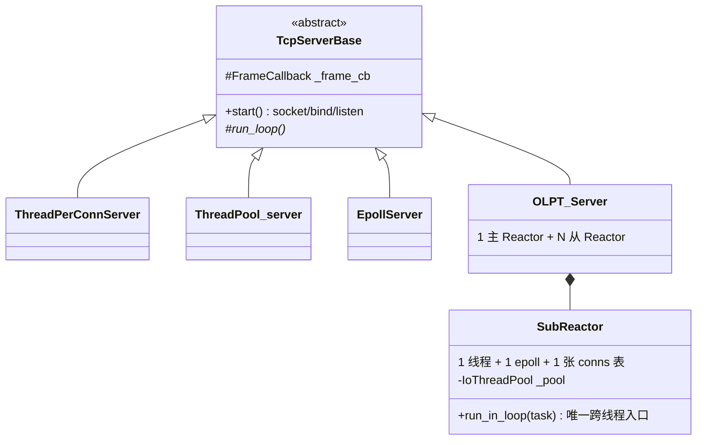

# socket_server

从零手写的 C++20 TCP 服务端。**五种并发模型 + 统一 TLV 协议 + 每个优化都有实测数字。**

不抄 muduo：每一层的坑自己踩，踩完写进 [`note/`](note/)，再用脚本量化验证。

---

## 亮点

| | 数据 |
|---|---|
| **五种并发模型同一接口** | 串行 / 一线程一连接 / 线程池 / epoll reactor / 主从 reactor，`--server=` 一键切换 |
| **量化出线程池的致命缺陷** | `workers=2` 时 2 条只连不发的连接即可饿死全部请求，`recv=0 errors=1`，且**完全静默** |
| **主从 Reactor 挂业务池** | 阻塞业务下 12 连接耗时 `2.18s → 0.18s`（**12.3×**），与单 Reactor 持平 |
| **写路径闭环** | `EAGAIN` + wbuf + `EPOLLOUT`；修复前 8 MB 丢 76%，修复后 `mismatch=0`、吞吐 `425 → 17618 msg/s` |
| **协议三层回归网** | C++ 单元 96 断言 + Python 参考实现交叉验证 + 端到端 6 套件 |

**核心代码 3,251 行**（`lib/` 1,177 + `src/` 2,074），测试 6,019 行，笔记 5,607 行。

---

## 快速开始

```bash
# 依赖：CMake ≥ 3.16、g++ ≥ 11（C++20）、pthread、nlohmann/json
cmake -S . -B build && cmake --build build -j

# 压测服务端（运行时切换模型）
./build/bench_server --server=olpt  --port=6200 --workers=4 --pool-per-sub=1
./build/bench_server --server=epoll --port=6200
./build/bench_server --help

# 客户端（thread/pool/epoll/olpt 必须加 --tlv，base 不要加）
python3 test/net/bench_client.py --port=6200 --mode=smoke      --conns=50 --msgs=20 --tlv
python3 test/net/bench_client.py --port=6200 --mode=throughput --conns=20 --msgs=300 --size=4096 --tlv

# 五模型对比 / 队头阻塞实验
python3 test/net/bench_compare.py
python3 test/net/block_compare.py --no-build
```

> **`--tlv` 不是可选项。** 走 `TLVDecoder` 的模型收到裸字节第一帧就判 `BAD_ERROR` 并断连，
> 客户端只会看到超时——这个坑曾经骗了我半天。

---

## 架构

`TcpServerBase::start()` 把 `socket → SO_REUSEADDR → bind → listen` 写死，
**唯一的接缝是纯虚 `run_loop()`**：



```
lib/     blocking_queue  Iothread_pool  thread_pool  jthread  Connection
         epoll(RAII)  frame(24B TLV + adler32 + TLVDecoder)
src/     server/tcp_server     模板方法基类
         protocol/tlv_defs      Cmd 枚举 + Msg_Handle_Echo
         mthread/               五种并发模型各一个文件
test/    unit/ 纯内存断言   tlv/ Python 协议参考实现
         suites/ 01–06 端到端   net/ 压测与测量工具
note/    stage1–6 踩坑全记录 + Reactor / 定时器专题
```

---

## 五种模型

| 模型 | 并发度 | 致命缺陷 |
|---|---|---|
| 串行 `base` | 1 | 一个客户端饿死所有人 |
| 一线程一连接 `thread` | ∞ | 1 万连接 ≈ 80 GB 虚拟栈；`detach + this` = UAF |
| 线程池 `pool` | worker 数 | **阻塞 `recv` 焊死 worker**，退化成"有上限的一线程一连接" |
| epoll `epoll` | 万级 | 1 reactor 管所有 I/O + 业务，业务一阻塞全局停摆 |
| 主从 reactor `olpt` | 万级 × N | 实现复杂度陡增；轮询分发导致负载不均 |

### 实测：业务阻塞下的表现（E4，1 worker，12 连接）

| 模型 | 耗时 | 说明 |
|---|---|---|
| `epoll` | **0.176 s** | reactor 不受影响，业务在 worker 里阻塞 |
| `olpt` 不挂池 | 2.179 s | 业务直接跑在从 reactor 的 I/O 线程 → 该 shard 一起停摆 |
| `olpt` 挂池 | **0.177 s** | 每个 sub 挂 1 个业务线程后与 epoll 持平（12.3×） |

### 实测：队头阻塞（E3，8 连接，1 条发慢请求）

`olpt` 每个 sub 只挂 1 个业务线程时，同 shard 的 7 条连接全部受害（800 ms）；
`--pool-per-sub=2` 后 **0/7 受害**（1.0 ms）。线程数 `1主 + 4sub + 4worker = 9`，可预测。

> 受害者恒定是 `[4]`：`dispatch()` 用 `_next % N` 轮询，fd0 和 fd4 落进同一个 sub。

---

## 协议

24 字节定长头，全大端：

```
 0   magic     4B  0x664A5455
 4   len       4B  body 长度，上限 10 MB
 8   cmd       4B  Module<<24 | MsgType<<16 | Action
12   seq       4B  响应原样回填
16   flag      4B  保留
20   checksum  4B  adler32(header[0..20) + body)
```

**错误分级的判据是「帧边界还可不可信」，不是「错得多离谱」**：

| Status | 处置 | 理由 |
|---|---|---|
| `NEED_MORE` | 保留缓冲区，等下次 | 半帧是正常现象 |
| `ERROR`（checksum 错） | **只丢这一帧，继续解析** | `len` 是好的，边界仍可信 |
| `BAD_ERROR`（magic/len 非法） | **清空缓冲区 + 断连** | 连下一帧从哪开始都不知道 |

> 最初三个服务端都写成 `if (NEED_MORE || ERROR) break;` —— 库设计的"只丢一帧"被调用方架空，
> 一个坏帧能带走后面所有好帧。同一个 bug 要改三个文件，这也正是 `tlv_codec.hpp` 要解决的。

---

## 测试

| 套件 | 覆盖 |
|---|---|
| `unit/frame_test.cpp` | 96 断言：布局 / 粘包 / 拆包 / 坏帧 / 边界 |
| `tlv/tlv_probe.py` | 协议第二份独立实现，与 C++ 交叉验证 |
| `suites/01_emfile.sh` | fd 耗尽：CPU `100% → 0%`，日志 `58 万行/2s → 2 行/2s` |
| `suites/02_blocking_queue.sh` | 56 断言，O0 / O2 / TSan 三档 |
| `suites/03_pool_starvation.sh` | 线程池饿死 / 队满 / 线程数三组复现 |
| `suites/04_epoll.sh` | 8 阶段正确性，含 500 空闲连接与 fd 回收 |
| `suites/05_tlv.sh` | 6 组，含**坏 checksum 丢帧但不断连** |
| `suites/06_timer.sh` | 空闲超时正反两面（该杀的杀、不该杀的不误伤） |
| `net/manual_check_wbuf.py` | 压 `SO_RCVBUF` 强制 `EAGAIN`，验 wbuf 不重发不丢 |

```bash
./test/suites/04_epoll.sh                       # 单跑
for s in test/suites/0*.sh; do "$s"; done       # 全跑
```

退出码统一：`0` PASS / `1` FAIL / `2` 环境问题。

---

## 已知缺陷

**现在就有、只是还没被触发：**

| # | 缺陷 | 严重度 |
|---|---|---|
| 1 | `wbuf` 无上限，慢客户端不读 → 内存无限涨（64 MB 大包时 RSS 峰值 83 MB，其中 64 MB 就是 wbuf） | 🟠 |
| 2 | 无连接数上限、无空闲超时 → slowloris 可耗尽 fd（`06_timer.sh` 就是为此写的） | 🟠 |
| 3 | 三个服务端各写一份 decod 循环，协议任何修正要改三处 | 🟠 |
| 4 | `_listen_fd` 非原子，`stop()` 与析构可能双重 `close` | 🟠 |
| 5 | `Connection::wbuf_retrieve` 用 `erase(0,len)`，大包频繁部分写是 O(n²) | 🟡 |
| 6 | `factory.hpp` 为空 → 业务硬编码 `if (cmd == EchoReq)`，第二个业务进来就要重构 | 🟡 |
| 7 | `PongResp` 名不符实（它是 Ping 的响应，应为 `PingResp`） | ⚪ |

---

## Roadmap

- ✅ 五模型 + TLV 协议 + 三层回归网 + 写路径闭环
- ⏳ **空闲超时**：接口与测试已就位，扫描逻辑待实现（阶段 3 的前置）
- ⏳ 消息分发：`factory.hpp` 按 `cmd` 注册 handler
- ⏳ 背压：`wbuf` 上限 + 已有连接限流（不只拒新连接）
- ⏳ 定时器（时间轮）、异步日志
- 🔜 HTTP/1.1 + 反向代理 → WebSocket → TLS

---

## 笔记

踩坑记录比代码更值得看，每篇都是"先崩一次再写"：

| 文件 | 主题 |
|---|---|
| `note_stage2_accept错误处理与fd耗尽.md` | 忙等自旋、指数退避、五态机 |
| `note_stage3_线程池踩坑.md` | `std::move` 后忘 `pop_front`、`catch` 抓不住 `throw 42` |
| `note_stage5_为什么线程模型在高并发下失效.md` | **架构转折**：thread → reactor 的完整推导 |
| `note_stage6_epoll踩坑.md` | 36 条，含 `EPOLLOUT` 忙等、`close` 唤不醒 `recv`、fd 复用 |
| `note_base_为什么高性能服务器要加定时器.md` | 时间轮 vs 小根堆 |

---

个人学习项目，无 License。错误欢迎指正。