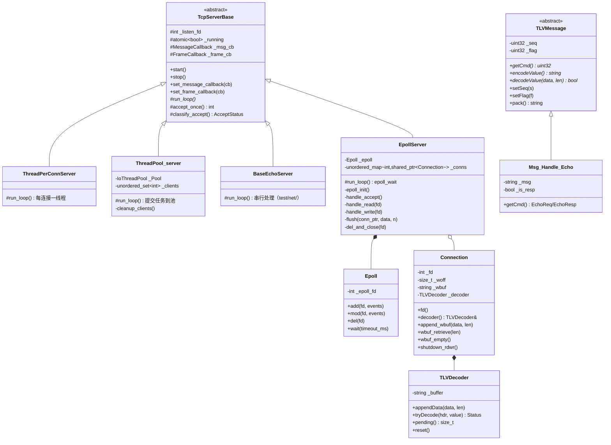

# socket_server

一个从零手写的 C++17 TCP 服务端，目标是**沿着真实工业路径，一步步把这套东西做到产品级**。

不是抄一个 muduo 就完事——每一层的坑都自己踩一遍，踩完写笔记（`note/`），
再用脚本量化验证（`test/`）。

当前处于**协议层落地**阶段：四种并发模型已全部跑通，epoll / reactor 的
读写路径已闭合；在此基础上新增了 **24 字节定长 TLV 帧协议**
（`magic | len | cmd | seq | flag | checksum`），三种并发模型统一改走
`TLVDecoder` 增量分帧，并有 **C++ 单元测试 + Python 参考实现 + 端到端套件**
三层回归网兜底。下一步是收敛三份重复的 decod 循环（`tlv_codec.hpp`）
与写缓冲上限（backpressure）。

---

## 目录

- [一、当前进度总览](#一当前进度总览)
- [二、架构](#二架构)
- [三、目录结构](#三目录结构)
- [四、构建与运行](#四构建与运行)
- [五、并发模型](#五并发模型)
- [六、协议层](#六协议层)
- [七、测试](#七测试)
- [八、踩坑笔记](#八踩坑笔记)
- [九、距离产品级还有多远](#九距离产品级还有多远)
- [十、Roadmap](#十roadmap)

---

## 一、当前进度总览

**代码量：约 2330 行**（`lib/` 1155 + `src/` 1171，不含笔记 5171 行与测试 4806 行）。

### 已实现 ✅

| 模块 | 内容 |
|---|---|
| **TCP 基础封装** | `socket → SO_REUSEADDR → bind → listen → accept → recv → send → close` 全流程封装进 `TcpServerBase` |
| **模板方法骨架** | `start()` 写死固定流程，只把 `run_loop()` 留成纯虚 —— 换并发模型只改一个函数 |
| **accept 错误治理** | 五态机（`Accept / RetryNow / Backoff / Stopped / Fatal`）+ 指数退避 + 日志节流 |
| **有界阻塞队列** | `BlockingQueue<T>`：`push`（阻塞）/ `try_push` / `pop` / `try_pop` / `close`，容量在构造期校验 |
| **IO 线程池** | `IoThreadPool`：`submit` 返回 bool、`try_run_one` 让调用者线程分担、`shutdown` 用 `call_once` 幂等、worker 全异常捕获 |
| **通用线程池** | `Classical_ThreadPool`：`enqueue` 返回 `std::future`，C++17 `tuple + std::apply` 完美转发 |
| **RAII 线程** | `my_jthread`：析构自动 join，禁拷贝只可移动 |
| **RAII 连接** | `Connection`：`close()` 只出现在析构函数里，禁拷贝，`shutdown_rdwr()` 用于唤醒阻塞 recv，**内含一个 `TLVDecoder`** |
| **epoll 封装** | `Epoll`：`epoll_create1` / `ctl`（`add`/`mod`/`del`）/ `wait` 三个原语，RAII + 移动语义 + 事件缓冲复用 |
| **TLV 帧协议** | `frame.hpp`：24 B 定长大端头（`magic=0x664A5455` / `len` / `cmd` / `seq` / `flag` / `checksum`），`len` 上限 10 MB，`checksum` 用 adler32 覆盖「头前 20 B + body」 |
| **增量分帧** | `TLVDecoder`：`appendData` 累积 + `tryDecode` 一次吐一帧；`PENDING / OK / NEED_MORE / ERROR / BAD_ERROR` 五态，粘包拆包天然支持 |
| **错误分级** | `BAD_ERROR`（magic/len 非法 → 流不可信，断开）；`ERROR`（checksum 错 → **只丢这一帧**，后续继续解析）。三个服务端已统一按此分级 |
| **帧回调链路** | `FrameCallback` 与 `MessageCallback` 并存：`set_frame_callback` 收到已分帧的 `(fd, hdr, body)`，业务不再碰字节 |
| **并发模型 ①** | `ThreadPerConnServer`：一连接一线程（`detach`），用作对比基线 |
| **并发模型 ②** | `ThreadPool_server`：有界队列 + 背压（队列满 → 拒绝连接）+ 优雅关闭 |
| **并发模型 ③** | `EpollServer`：`epoll_init` / `handle_accept` / `handle_read` / `handle_write` / `del_and_close` 全部实现，含 wbuf + `EPOLLOUT` 半写处理 |
| **并发模型 ④（基线）** | `BaseEchoServer`（`test/net/`）：串行一连接处理，作为性能零点参照 |
| **写路径（wbuf）** | `send` 遇 `EAGAIN` → 残余落 `wbuf` + 注册 `EPOLLOUT`；可写事件触发 `handle_write` → `send` + `wbuf_retrieve` 推进；排空后 `mod(fd, EPOLLIN)` 摘掉 `EPOLLOUT` |
| **压测脚手架** | `bench_server`（`--server=base\|thread\|pool\|epoll` 运行时切换）+ `bench_client.py`（asyncio，`--tlv` 组帧，失败分类） |
| **优雅关闭链路** | `SIGINT → stop() → accept 返回 EBADF → Stopped → cleanup_clients() → worker join` |
| **量化测试** | EMFILE 治理（CPU 100%→0%）、队列语义（**56 断言**）、线程池加速比（2.75x）、**线程池饿死复现**、**大包收发平衡校验**、**帧协议 96 断言 + 8 组探针 + 6 组端到端** |

### 未实现 ❌

定时器、日志系统、主从 reactor、写缓冲上限（backpressure）、
连接级限流、QPS / P99 量化对比……

完整差距分析见[第九节](#九距离产品级还有多远)。

---

## 二、架构

### 继承体系



**唯一的差异点是 `run_loop()`**。`start()` 的流程所有模型完全一致：

```
start()
  ├─ create_socket()       socket(AF_INET, SOCK_STREAM, 0)
  ├─ set_reuse_addr()      SO_REUSEADDR，解决 TIME_WAIT 端口占用
  ├─ do_bind()             bind
  ├─ do_listen()           listen(backlog)
  ├─ _running = true
  └─ run_loop()            ★ 子类决定"怎么并发"
```

### 一次连接的生命周期（线程池模型）

```
SIGINT
  │
  ▼
stop()                        [信号上下文] 只做两件异步信号安全的事
  ├─ _running = false
  └─ close(_listen_fd)
        │
        ▼
accept() 立刻返回 -1, errno = EBADF
        │
        ▼
classify_accept → Stopped
        │
        ▼
break → run_loop 末尾 cleanup_clients()   [普通线程上下文]
        ├─ 持 _mtx 遍历 _clients → shutdown(fd, SHUT_RDWR)   只叫醒
        └─ _Pool.shutdown()  → worker 排空后 join
                │
                ▼
        worker: recv 返回 0 → break → 持 _mtx → erase + close   唯一出口
```

---

## 三、目录结构

```
socket/
├── CMakeLists.txt
├── lib/                          通用组件（与业务无关）
│   ├── blocking_queue.hpp          有界阻塞队列（push / try_push / pop / try_pop / close）
│   ├── Iothread_pool.hpp           服务端专用线程池（submit / try_run_one 返回 bool）
│   ├── thread_pool.hpp             通用线程池（enqueue 返回 future）
│   ├── thread_pool_v2.hpp          线程池改进版（每线程本地队列）
│   ├── thread_safe_queue.hpp       教学版队列（未使用，保留对比）
│   ├── jthread.hpp                 RAII join 线程
│   ├── Connection.hpp              RAII 连接（close 只出现在析构里）+ 内嵌 TLVDecoder
│   ├── epoll.hpp                   epoll 三原语封装（create1 / ctl / wait）
│   └── frame.hpp                   ★ 24B TLV 帧：magic/len/cmd/seq/flag/checksum
│                                     + adler32 + TLVMessage + TLVDecoder
├── src/
│   ├── main.cpp                    入口：参数解析 + 模型选择 + 信号注册
│   ├── server/
│   │   ├── tcp_server.hpp          模板方法基类（MessageCallback + FrameCallback）
│   │   └── tcp_server.cpp          原语实现
│   ├── protocol/                   协议层（业务消息定义）
│   │   ├── tlv_defs.hpp              Cmd 枚举 + Msg_Handle_Echo（唯一非空文件）
│   │   ├── factory.hpp               ⬜ 空文件（等第二个消息类型再写）
│   │   ├── tlv_codec.hpp             ⬜ 空文件（待收敛三份重复 decod 循环）
│   │   ├── tlv_framer.hpp            ⬜ 空文件（与 TLVDecoder 职责重叠，暂缓）
│   │   └── raw_framer.hpp            ⬜ 空文件（base 模型不分帧，暂缓）
│   ├── mthread/                    并发模型（每种模型一个文件）
│   │   ├── pthread_server.hpp        一连接一线程
│   │   ├── thread_pool_server.hpp    线程池 + 背压
│   │   └── Epoll_server.hpp          epoll / reactor（读写路径已闭合）
│   └── demo/server.cpp             早期 demo（已注释，保留）
├── test/                         测试（按「测什么」分目录，详见 test/README.md）
│   ├── unit/                     纯内存单元测试（无 socket）
│   │   ├── frame_test.cpp           帧协议 96 断言（布局/粘包/坏帧/边界）
│   │   ├── blocking_queue_test.cpp  队列 + try_run_one
│   │   └── thread_pool_test.cpp    线程池加速比
│   ├── tlv/tlv_probe.py           TLV 协议 Python 参考实现（8 组自测）
│   ├── suites/                   端到端套件（编号即执行顺序）
│   │   ├── 01_emfile.sh             fd 耗尽：CPU 占用 + 日志增长
│   │   ├── 02_blocking_queue.sh     队列语义（56 断言，含 TSan）
│   │   ├── 03_pool_starvation.sh    线程池饿死复现（3 个实验）
│   │   ├── 04_epoll.sh              epoll 正确性（8 个阶段）
│   │   └── 05_tlv.sh                TLV 链路（6 组，含坏帧不断连）
│   ├── net/                      压测/测量工具（输出数字，不做断言）
│   │   ├── bench_server.cpp         压测入口（--server=base|thread|pool|epoll）
│   │   ├── base_echo_server.hpp     串行基线（性能零点参照）
│   │   ├── bench_client.py          asyncio 客户端（--tlv 组帧 + 失败分类）
│   │   ├── bench_compare.py         四模型 × 三场景横向对比
│   │   ├── bigfile_echo.py          大文件字节级回环校验
│   │   ├── echo_bytes.py            以文件为载荷的逐字节校验
│   │   ├── handle_write_trigger.py  专门触发 EPOLLOUT 分支
│   │   ├── manual_check_wbuf.py     验证 wbuf 不重复发送
│   │   └── data/hamlet              199,813 B 测试载荷
│   ├── debug/gdb_epoll_accept.cmds  gdb 批处理脚本
│   └── archive/                  历史遗留、已被替代，保留备查
└── note/                         踩坑笔记（按阶段，共 5171 行）
    ├── note_stage1_TCP服务端踩坑.md
    ├── note_stage2_accept错误处理与fd耗尽.md
    ├── note_stage3_线程池踩坑.md
    ├── note_stage4_线程池服务端收尾与关闭踩坑.md
    ├── note_stage5_为什么线程模型在高并发下失效.md
    ├── note_stage6_epoll踩坑.md
    ├── note_base_Reactor理解以及主从Reactor改进理解
    └── note_base_复习代码顺序
```

---

## 四、构建与运行

### 构建

```bash
cmake -S . -B build -DCMAKE_EXPORT_COMPILE_COMMANDS=ON
cmake --build build -j
```

依赖：CMake ≥ 3.16、g++ ≥ 9（C++17）、pthread、**nlohmann/json ≥ 3.11**（`find_package(nlohmann_json 3.11 REQUIRED)`）。

### 运行

**方式 A：`socket_server`（手动验证，模型写死在 `src/main.cpp`）**

```bash
./build/socket_server 6003        # 端口，默认 6003
```

**方式 B：`bench_server`（压测 / 对比模型，运行时切换）**

```bash
./build/bench_server --server=base   --port=6201   # 串行基线
./build/bench_server --server=thread --port=6201
./build/bench_server --server=pool   --port=6201 --workers=4 --queue-cap=1024
./build/bench_server --server=epoll  --port=6201          # 四个模型名都是全小写
./build/bench_server --help
```

> **二进制在 `build/` 下，不在 `test/` 下。**
> `test/net/bench_server.cpp` 只是源码，编译产物统一落在 `build/`。

### 验证

```bash
# 多轮 echo（-N = EOF 后立即发 FIN）——只有 base 模型吃裸字节
printf 'hello\nworld\nthird\n' | nc -N 127.0.0.1 6003

# 优雅退出，退出码必须是 0（不是 134）
./build/socket_server 6003 &
kill -INT $!
wait $!; echo "exit=$?"

# 用压测客户端（asyncio，2000 连接只占 1 个客户端线程）
# base 用裸字节，其余三个模型必须加 --tlv
python3 test/net/bench_client.py --port=6201 --mode=smoke --conns=1   --msgs=1
python3 test/net/bench_client.py --tlv --port=6201 --mode=latency \
        --conns=10 --msgs=10
```

> **`--tlv` 是必须的，不是可选的。**
> `thread` / `pool` / `epoll` 三个模型收到数据第一件事就是过 `TLVDecoder`，
> 裸字节没有 `magic` → 直接判 `BAD_ERROR` → 断开连接 → 客户端只看到超时。
> 只有 `base` 模型走 `set_message_callback` 老路径，吃裸字节。

---

## 五、并发模型

| 模型 | 文件 | 并发度 | 优点 | 致命缺陷 |
|---|---|---|---|---|
| **串行** | 待补（`BaseEchoServer`） | 1 | 零开销、零竞争 | 一个客户端能饿死所有人 |
| **一连接一线程** | `pthread_server.hpp` | ∞（无上限） | 实现最简单 | 1 万连接 ≈ 80GB 虚拟栈；`detach + this` = UAF；无法优雅关闭 |
| **线程池** | `thread_pool_server.hpp` | 硬上限（worker 数） | 有背压、可优雅关闭 | **阻塞 `recv` 焊死 worker**，长连接下退化成"一连接一线程 + 上限 N" |
| **epoll / reactor** | `Epoll_server.hpp` | 万级连接 | 单线程管万连接，无线程开销 | 需要非阻塞 I/O + 状态机，复杂度陡增 |

### 三个缺陷的实测证据

`test/suites/03_pool_starvation.sh` 用三个实验把线程池模型的缺陷变成可复现的数字：

| 实验 | 场景 | 实测结果 |
|---|---|---|
| **A 饿死** | `workers=2`，2 条只连不发的连接占满 worker，第 3 条发请求 | **pool：`recv=0, errors=1`（超时无响应）**；thread：`recv=3`（正常） |
| **B 队满** | `workers=1 queue-cap=1`，worker 占满 + 队列塞满，第 3 条连接 | `eof_early=1, recv=0` —— 只能踢掉新连接，无法给已有连接限流 |
| **C 线程数** | 20 条 hold 连接，数 `/proc/PID/task` | thread **21 线程** vs pool(workers=4) **5 线程** |

> 实验 A 最可怕的地方是**它完全静默**：`accept` 成功、`submit` 成功、
> fd 进了 `_clients`，没有任何错误日志，CPU 不升、内存不涨。
> 客户端只看到一个超时。这种 bug 在生产环境能活好几个月。

完整的成因分析见 [`note_stage5_为什么线程模型在高并发下失效.md`](note/note_stage5_为什么线程模型在高并发下失效.md)。

### 三种模型的核心差异：只有一处

得益于模板方法，`start()` 的流程三种模型完全一致，**唯一的接缝是 `run_loop()`**：

```cpp
// thread 模型
while (running) { accept → new std::thread(handle_client_read) → detach }

// pool 模型
while (running) { accept → _Pool.submit([]{ handle_client_read(fd); }) }

// epoll 模型
while (running) { epoll_wait → 遍历就绪事件 → handle_read(fd) }
```

差别只有 20 行，但**任务时长**差了三个数量级：

| | thread | pool（阻塞版） | epoll |
|---|---|---|---|
| 任务是什么 | 整个连接生命周期 | 整个连接生命周期 | **一次就绪事件** |
| 任务时长 | 分钟~小时 | 分钟~小时 | **微秒~毫秒** |
| worker 归还 | ❌ 不归还 | ❌ 不归还 | ✅ 每次处理完即归还 |

### 切换方式

**方式 A（当前）**：改 `src/main.cpp` 两行

```cpp
#include "mthread/thread_pool_server.hpp"   // ← 换 include
ThreadPool_server server(port);             // ← 换类型
```

**方式 B**：CMake 多个 `add_executable` + 编译期宏

**方式 C（已实现）**：运行时 `--server=thread|pool|epoll`（`std::unique_ptr<TcpServerBase>` 分派）

```bash
./build/bench_server --server=thread --port=6201
./build/bench_server --server=pool   --port=6201 --workers=4
./build/bench_server --server=epoll  --port=6201
```

> **注意**：`TcpServerBase` 有纯虚 `run_loop()`，**不能直接实例化**。
> 想跑串行基线必须写一个最小派生类。另外 `g_server` 必须声明成 `TcpServerBase*`，
> 否则切换模型时会编译失败。
>
> 模型名为**全小写**：`thread` / `pool` / `epoll`。传错会返回 exit 2。
> 不带参数时默认 `--server=thread`。

### epoll 模型的写路径：`wbuf` + `EPOLLOUT`

这是整个 epoll 模型**最难写、最容易漏**的部分。非阻塞 `send` 随时可能只写一半，
剩下的必须存起来等可写事件，否则数据静默丢失。

状态机（`flush()` 一处实现，两个调用点驱动）：

```
空闲：wbuf 空 + 未注册 EPOLLOUT
   │ send_wbuf() → flush() → send() 全部进内核
   ▼
内核缓冲满 → EAGAIN → 残余落 wbuf + mod(fd, EPOLLIN|EPOLLOUT)
   │
   ▼  对端 read → TCP 窗口滑动 → 内核腾出空间
   │
   ▼  EPOLLOUT 触发 → handle_write() → flush(conn, nullptr, 0)
   │     循环 send + wbuf_retrieve(n) 推进缓冲区
   ▼
wbuf 排空 → mod(fd, EPOLLIN) 摘掉 EPOLLOUT → 回到空闲
```

两个调用点：

| 调用点 | 入口 | 语义 |
|---|---|---|
| 业务要发数据 | `send_wbuf(fd, data, len)` → `flush(conn, data, len)` | 先还旧欠账，再发新数据 |
| 可写事件到了 | `handle_write(fd)` → `flush(conn, nullptr, 0)` | 纯冲刷，`len==0` 时新数据段自动跳过 |

**四条不能错的红线**：

1. **`EPOLLOUT` 属于 LT 模式**，只要注册着就会一直返回。发完不忘 
   `mod(fd, EPOLLIN)` 摘掉 → `while(running)` 变成 100% CPU 忙等。
2. **必须先还旧欠账再发新数据**。`wbuf` 里是上次的残留，TCP 是字节流，
   新数据插到旧数据前面就是乱序。
3. **`send` 返回 0 在 TCP 上不能继续循环**。长度不推进 → 死循环，当错误处理。
4. **`EPOLLIN` 和 `EPOLLOUT` 用两个独立 `if`**，同一 fd 完全可能同时可读可写。

实测（Linux loopback，4 核）：

| 指标 | `handle_write` 空壳 | 修复后 |
|---|---|---|
| 20连接×2000条×4096B 消息数 | `recv=13302 / sent=40000` | **`recv=sent=40000`** |
| `mismatch` | 20 | **0** |
| 吞吐 | 425 msg/s | **17618 msg/s** |
| CPU | 100%（LT 忙等） | **19.6%** |
| P50 延迟 | 30,796 ms | **1,584 ms** |
| 8 MB 大包放大倍数 | 0.24x（丢 76%） | **1.00x** |

> 阶段 [6]（64 B 小包）**无法触发 `EAGAIN`**，因为默认 `tcp_wmem` 就有 16 KB，
> 500 条消息总共 32 KB 也可能一次性全部塞进内核。所以它永远是绿的，
> 这是**假绿**。真正的验证必须用 `manual_check_wbuf.py` 强制造出 `EAGAIN`。

### 线程池模型的核心认知

`ThreadPool_server` **当前不是终态**。它的 `submit` 提交的是
`handle_client_read(fd)`——一个**整个连接生命周期内不返回**的长任务。
这导致 worker 一旦被长连接占住就再也不会回到队列。

所以它的真正价值不是"提升吞吐"，而是**验证背压链路**：

```
队列满 → try_push 返回 false → 拒绝新连接（close fd）→ 客户端重连
```

要让它真正发挥威力，必须把阻塞 `recv` 换成 **非阻塞 + epoll**，让任务变成"短任务"。
这是 `Epoll_server.hpp` 正在做的事。

---

## 六、协议层

### 为什么要有帧

TCP 是**字节流**，不是消息流。客户端发两次 `send("hello")` + `send("world")`，
服务端完全可能一次 `recv` 拿到 `"helloworld"`，也可能分三次拿到 `"he"` `"llowo"` `"rld"`。
这就是**粘包与拆包**——不是 bug，是 TCP 的设计。

解决办法只有一个：**在字节流里划出消息边界**。本项目选长度头方案。

### 24 字节定长头

```
偏移  长度  字段        说明
 0     4   magic     0x664A5455（"BJTU"），一眼认出这是本协议的流
 4     4   len       body 字节数，上限 10 MB
 8     4   cmd       高 8 位 Module | 中 8 位 MsgType | 低 16 位 Action
12     4   seq       请求序号，响应必须原样回填
16     4   flag      保留位
20     4   checksum   adler32 覆盖「头前 20 B + body」
────  ──
24     6 个 uint32，全部大端（htonl）
```

三个设计细节值得单独说：

**① `len` 只算 body，不含头。** 总长度永远是 `24 + len`，无需查表。
写测试时也照此表达，**禁止出现魔法数字**——`kHeaderSize + body.size()`，
否则头一改大小所有断言全废（这一条付过代价，见[第八节](#八踩坑笔记)第 12 条）。

**② checksum 覆盖头 + body，但先把 `checksum` 字段本身清零。**
如果只校验 body，头部被篡改（比如 `cmd` 从 `EchoReq` 改成 `DeleteReq`）
就完全发现不了。清零是为了消除「算校验和要先知道校验和」的循环依赖。

**③ 空 body 的 adler32 是 `1`，但一个合法帧的 checksum 永远不可能是 1。**
因为被校验的范围至少包含 20 字节头。写断言时用
`checksum != 1 && checksum != 0` 才安全。

### 错误分级：一套枚举，两种处置

这是整个协议层**最容易做错**的地方。`TLVDecoder::Status` 只有四个值：

```cpp
enum class Status { OK, NEED_MORE, BAD_ERROR, ERROR };
```

| Status | 含义 | 处置 | 为什么 |
|---|---|---|---|
| `OK` | 拿到一帧完整的 | 交业务回调，**继续循环解下一帧** | 粘包就在这里被拆开 |
| `NEED_MORE` | 数据不够，等下一次 `recv` | **跳出循环，保留缓冲区** | 半帧是正常现象，不是错误 |
| `ERROR` | **checksum 错** | **只丢这一帧，继续解析** | 帧边界仍然可信，后面的帧是好的 |
| `BAD_ERROR` | **magic 或 len 非法** | **缓冲区清零 + 断开连接** | 帧边界已不可信，继续解析等于乱猜 |

`BAD_ERROR` 这个名字确实反直觉（它比 `ERROR` 更严重，名字却只是加个前缀）。
**判据是「帧边界还可不可信」，不是「错得有多离谱」**：

```
ERROR      → 我知道这一帧在哪里结束（len 是好的），丢掉它继续
BAD_ERROR  → 我连下一帧从哪里开始都不知道，只能整条流作废
```

> 这个分级最初没做对：三个服务端都写成 `if (st == NEED_MORE || st == ERROR) break;`，
> 意思是 checksum 错就跳过缓冲剩余部分。这样一来 `TLVDecoder` 内部
> 「只丢这一帧」的设计被调用方彻底架空——一个坏帧能带走它后面的所有好帧。
> 修复后才对：`ERROR` 不进 `break` 条件，`BAD_ERROR` 才是断连条件。

### 三个服务端的 decod 循环

`frame.hpp` 提供 `TLVDecoder`，但**每个模型都得自己写一遍这个循环**：

```cpp
for (;;) {
    auto st = decoder->tryDecode(hdr, body);
    if (st == TLVDecoder::Status::BAD_ERROR) { /* 流不可信 → 关连接 */ }
    if (st == TLVDecoder::Status::NEED_MORE) break;   // 半帧，等下次收
    if (st == TLVDecoder::Status::OK && _frame_cb) _frame_cb(fd, hdr, body);
}
```

三份代码几乎逐字相同（`pthread_server.hpp` / `thread_pool_server.hpp` /
`Epoll_server.hpp`），**但它们不是三份，是三份要同步维护的 bug**。
`ERROR`/`BAD_ERROR` 分级那个 bug 就得改三个文件。

这就是 `src/protocol/tlv_codec.hpp` 要解决的问题（**尚未实现**）：

```cpp
enum class Verdict { Ok, StreamBroken };   // 把三家的关闭处置压成一个返回值

class Reply {                              // 响应自动继承 seq
    void send(TLVMessage&) const;          // 结构上不可能忘记 setSeq
    int _fd; uint32_t _seq; Sender _sender;
};

using Handler = std::function<bool(int, const FrameHeader&,
                                   const std::string&, Reply&)>;
Verdict feed(int fd, const char* d, size_t n);   // 一个入口，三家共用
void    on(uint32_t cmd, Handler);               // 按 cmd 注册
size_t  dropped() const;                         // 坏帧计数，可观测
```

三个约束：**codec 里绝不存 `fd`**（fd 生命周期归 `_conns`/`_clients` 管）、
`Handler` 返回 `bool`（false = 回调里把连接关了，别再往下走）、
**纯内存可测，不碰 socket**。

### 业务消息

`TLVMessage` 只定义「怎么变成 body、怎么从 body 还原」，不含头：

```cpp
class TLVMessage {
    virtual uint32_t getCmd() const = 0;
    virtual std::string encodeValue() const = 0;
    virtual bool decodeValue(const uint8_t* data, size_t len) = 0;
    std::string pack() const;     // 非虚函数，全项目唯一一份组帧实现
};
```

`pack()` **故意不是虚函数**——组帧逻辑只有一份，想在子类里改也改不了。

`cmd` 的位段布局：

```
cmd = (Module << 24) | (MsgType << 16) | Action
       高 8 位          中 8 位         低 16 位
```

| 位段 | 值 | 含义 |
|---|---|---|
| Module | `0x01` | 当前只有 Echo 模块 |
| MsgType | `0x01` Req / `0x02` Resp / `0x03` Notify | 请求 / 响应 / 通知 |
| Action | `0x0001` Echo / `0x0002` Ping | 具体动作 |

所以 `EchoReq = 0x00010001`，`EchoResp = 0x00020001`，`PingReq = 0x00010002`。

### Python 参考实现：交叉验证

`test/tlv/tlv_probe.py` 是协议层的**第二份独立实现**（233 行，无第三方依赖）。
它的存在意义不是"方便测试"，而是**防止 C++ 单方面偷改协议**：

```
C++ frame.hpp          Python tlv_probe.py
     pack()      ≡           pack()          ← 字节必须逐一相同
  TLVDecoder     ≡         Decoder()        ← 分帧结论必须相同
```

任何一边改了字段偏移、字节序、校验范围，对照立刻失败。
这是**用两种语言互相当裁判**，比单语言测试强硬得多。

```bash
python3 test/tlv/tlv_probe.py      # 8 组纯内存自测，不需要服务端
```

覆盖：头布局与字节序、空 body、二进制 body、checksum 校验、
逐字节喂料（模拟最恶劣的拆包）、粘包、坏 magic、坏 checksum。

### 三层回归网

| 层 | 位置 | 覆盖 | 运行时长 | 依赖 |
|---|---|---|---|---|
| **1 单元** | `test/unit/frame_test.cpp` | 96 断言：布局/粘包/拆包/坏帧/边界值 | < 1 s | 无 |
| **2 参考实现** | `test/tlv/tlv_probe.py` | 8 组自测，与 C++ 交叉验证 | < 1 s | 无 |
| **3 端到端** | `test/suites/05_tlv.sh` | 6 组真实 socket 链路 | ~ 10 s | `bench_server` |

```bash
g++ -std=c++17 -Wall -Wextra -Werror -Ilib test/unit/frame_test.cpp -o /tmp/frame_test && /tmp/frame_test
python3 test/tlv/tlv_probe.py
./test/suites/05_tlv.sh --server=pool --strict
```

`05_tlv.sh` 的 6 组：单帧往返 + `seq` 回填、粘包两帧、分片发送、
空 body、**坏 checksum 丢帧但不断连**、**坏 magic 断连**。
加 `--strict` 后，坏帧导致断连也判 FAIL。

---

## 七、测试

### `test/suites/01_emfile.sh` —— fd 耗尽治理

```bash
./test/suites/01_emfile.sh              # 完整（编译 3 种模式）
./test/suites/01_emfile.sh --no-build   # 跳过编译
```

**判据**（硬指标，不看日志文案）：

| 指标 | 采集方式 | 阈值 |
|---|---|---|
| CPU | `/proc/PID/stat` 的 `utime+stime` 差分 | < 30% |
| 日志增长 | 窗口前后 `wc -l` 差值 | < 100 行 / 2s |

**实测对比**：

| 指标 | 修复前 | 修复后 |
|---|---|---|
| CPU | **100%** | 0% |
| 日志 | 580,941 行 / 2s | 2 行 / 2s |
| 结果 | FAIL | **PASS** |

### `test/suites/02_blocking_queue.sh` —— 队列语义与线程池契约

```bash
./test/suites/02_blocking_queue.sh              # O0 + O2 + TSan 全跑
./test/suites/02_blocking_queue.sh --no-tsan    # 跳过 TSan（容器里 mmap_rnd_bits=32 会报错）
./test/suites/02_blocking_queue.sh --only-tsan
```

**56 个断言**，全部 PASS（O0 / O2 / TSan 三种模式）：

| 组 | 覆盖 |
|---|---|
| 1–10 | 容量校验、`push` 阻塞唤醒、`try_push` 非阻塞、`pop` 空队列、`close` 唤醒所有等待者、幂等性 |
| **11 `try_pop`** | 空队列返回 false 且**不阻塞**；连续 3 次必须拿到 3 个不同元素（**能抓住漏写 `pop_front`**）；close 后仍能排空；capacity=1 满队列时唤醒生产者（验证用的是 `_not_full` 而不是 `_not_empty`） |
| **12 `try_run_one`** | 空池立即返回 false；**用 `thread::id` 证明任务跑在调用者线程**；`while(try_run_one())` 恰好排空 20 个；任务抛异常不外泄；4 worker + 主线程抢 5000 个任务，执行次数**精确等于 5000** |

> TSan 在本容器里需要 `setarch $(uname -m) -R`（`mmap_rnd_bits=32` 与 TSan 冲突），
> `test_02` 脚本已自动处理。

### `test/suites/03_pool_starvation.sh` —— 线程池饿死复现

```bash
./test/suites/03_pool_starvation.sh
./test/suites/03_pool_starvation.sh --no-build
```

三个实验（A 饿死 / B 队满 / C 线程数），判据只看**行为**不看日志文案。
完整数据见[第五节](#五并发模型)。这是"为什么必须转 reactor"的实测证据。

### `test/suites/04_epoll.sh` —— epoll 正确性与核心价值

```bash
./test/suites/04_epoll.sh              # 默认：阶段 1 失败就中止
./test/suites/04_epoll.sh --all        # 阶段 1 失败也继续跑完
./test/suites/04_epoll.sh --no-build   # 跳过编译
```

和 `03` 的区别：`03` 测**缺陷**（PASS = 缺陷被稳定复现），
`04` 测**正确性**（PASS = 行为符合预期）。七个阶段：

| 阶段 | 场景 | 判据 | 抓什么 |
|---|---|---|---|
| [1] 功能冒烟 | 1 连接 1 消息 | `recv==sent, mismatch==0` | 基本功 |
| [2] 并发冒烟 | 50 连接 × 3 消息 | `conn_ok==50, recv==150` | accept 循环 |
| [3] fd 回收 | 并发跑完 fd 数回落 | `fds_after <= fds_base + 2` | `handle_read` 缺 `n==0` 分支 |
| [4] 空闲连接 | 500 连接只连不发 | `conn_ok==500` 且服务端存活 | backlog 过小 |
| [5] 线程解耦 | 20 vs 500 连接的线程数 | 两者必须相等 | **epoll 的核心价值** |
| [6] 流水吞吐 | 20 连接 × 500 消息 | `partial==0, mismatch==0` | wbuf 半写处理 |
| [7] 大包压力 | 20 连接 × 2000 × 4 KB | `partial==0` 且 RSS 不暴涨 | wbuf 无上限 |

**当前状态：七个阶段全绿。** 阶段 [4] 曾因 `listen(fd, 5)` 只完成 480/502
而失败，改成 128 后通过；阶段 [6] 的 64 B 小包无法触发 `EAGAIN`，
是**假绿**，真正的写路径验证靠下面两个脚本。**只有阶段 [7] 能稳定撞出 `EAGAIN`。**

> 本套件调 `bench_client.py` 时**一律加 `--tlv`**。不加的话客户端发裸字节，
> epoll 模型的 `TLVDecoder` 会判 `BAD_ERROR` 直接断连，外部表现是 `TimeoutError`。

### `test/suites/05_tlv.sh` —— TLV 协议链路

```bash
./test/suites/05_tlv.sh                    # 默认 pool 模型
./test/suites/05_tlv.sh --server=epoll     # 换模型
./test/suites/05_tlv.sh --strict           # 坏帧不断连也判 FAIL
./test/suites/05_tlv.sh --no-build
```

六组，全部走真实 socket：

| 组 | 场景 | 判据 |
|---|---|---|
| 1 | 单帧往返 | body 一致 + `seq` 回填 + `flag==0` |
| 2 | 粘包两帧 | 两帧都被按序处理 |
| 3 | 分片发送 | 逐字节喂也不误判 |
| 4 | 空 body | `len==0` 也能正常回包 |
| 5 | **坏 checksum** | `ERROR` → 只丢这一帧，**后一帧仍被处理** |
| 6 | 坏 magic | `BAD_ERROR` → 断连 |

> 第 5 组是这一层最关键的一条：它验证的正是「**丢帧不断连**」这个设计意图。
> 曾经三个服务端都写成 `if (st == NEED_MORE \|\| st == ERROR) break;`，
> 一个坏帧会连带丢掉后面所有好帧。详见[第六节](#六协议层)。

### `test/net/manual_check_wbuf.py` —— 强制 `EAGAIN`，验证 wbuf 是否被重复发送

```bash
./build/bench_server --server=epoll --port=6421 &
python3 test/net/manual_check_wbuf.py 6421 8      # 8 MB
```

手段：客户端 `setsockopt(SO_RCVBUF, 8192)` 把接收窗口压到最小，
发完后**憋 6 秒不读**，强制服务端发送缓冲区饱和 → `send` 必然撞 `EAGAIN`
→ 残余进 `wbuf` → 触发 `EPOLLOUT`。

判据是**放大倍数 = 收到字节 / 发送字节**：

| 倍数 | 含义 |
|---|---|
| `1.00x` | ✅ 收发平衡，`wbuf` 消费正确 |
| `> 1.05x` | 🔴 `wbuf` 被重复发送（`wbuf_retrieve` 没调或参数错） |
| `< 0.95x` | 🔴 数据丢失 |

这个脚本抓出过真实缺陷：修复前 8 MB 只收到 1.98 MB（**丢失 76.4%**），
20 MB 丢失 **90.6%**。strace 给出的铁证是同一个 `sendto` 请求长度
`5804032` 连续出现两次（第一次成功写 884736，第二次仍按原长度重发），
说明 `wbuf` 从未推进。

> ⚠️ 注意：脚本内部的 25 s deadline 在 8 MB 量级会**误报缺失**
> ——`SO_RCVBUF=8192` 时每轮 `recv` 只有约 14.7 KB，完整收完 8 MB
> 需要约 112 s。判读以输出末尾的最终累计值（`全部收到`）为准。

### `test/net/bigfile_echo.py` —— 大文件字节级回环校验

```bash
python3 test/net/bigfile_echo.py 6421 64          # 64 MB
```

服务端正常读 + 客户端正常并发读，用来验证**不阻塞**的大包路径。
与 `manual_check_wbuf.py` 互补：这个测"正常情况不丢"，那个测"极端情况不重"。

实测：8 MB / 64 MB 均字节级完全一致，64 MB 时服务端 RSS 峰值 83 MB
（其中 64 MB 就是 `wbuf`），这是**缺少写缓冲上限**的直接证据。

### `test/unit/thread_pool_test.cpp` —— 加速比

```bash
g++ -std=c++17 -O2 -Wall -Wextra -I./lib -pthread \
    test/unit/thread_pool_test.cpp -o /tmp/pooltest && /tmp/pooltest
```

**实测**（4 核，10 万任务）：

```
线程池总耗时 374 ms     单线程 1027 ms     加速比 2.75x
结果校验：一致 PASS
```

> 加速比 2.75x 而非 4x，说明并非纯 CPU 密集 —— 任务里含队列锁竞争。
> 这是"锁粒度"对吞吐影响的第一个量化证据。

### 退出码约定

所有脚本统一：`0 = PASS`，`1 = FAIL`，`2 = 环境/构建问题`。

---

## 八、踩坑笔记

| 文件 | 主题 | 行数 |
|---|---|---|
| `note_stage1_TCP服务端踩坑.md` | socket 原语、参数陷阱、阻塞 I/O 本质 | 198 |
| `note_stage2_accept错误处理与fd耗尽.md` | accept 失败治理、忙等自旋、fd 泄漏 | 1016 |
| `note_stage3_线程池踩坑.md` | 队列/线程池实现、编译期与并发正确性 | 992 |
| `note_stage4_线程池服务端收尾与关闭踩坑.md` | 连接收尾、优雅关闭、信号安全、模型切换 | 761 |
| `note_stage5_为什么线程模型在高并发下失效.md` | **架构转折**：thread → reactor 的完整推导与实测证据 | 596 |
| `note_stage6_epoll踩坑.md` | epoll 五态机、非阻塞 I/O、wbuf 半写、EPOLLOUT 陷阱 | 1535 |
| `note_base_Reactor理解以及主从Reactor改进理解` | 主从 reactor 的推导，阶段 9 的预习笔记 | 66 |
| `note_base_复习代码顺序` | 回看代码的建议顺序 | 7 |

**几条最贵的教训**（都付了实测代价）：

1. `std::function<void>` 少了 `()` —— 一个拼写引起 10 个连锁错误
2. `accept()` 里 `perror` + `continue` = CPU 100% + 每秒 30 万行日志
3. `submit` 用阻塞 `push` —— accept 循环卡死 2 秒，**为防过载造成更严重过载**
4. `catch(const std::exception&)` **抓不住 `throw 42`** —— 整个进程 `terminate`
5. 收尾块写进 `while` 循环体 —— 同时造成"提前 close"和"永不 close"两种相反 bug
6. `accept_once` 里 `throw` —— 精心设计的五态机完全跑不到，Ctrl+C 变退出码 134
7. `cleanup_clients` 放进 `stop()` —— 信号上下文里 `mutex::lock` = 死锁
8. `close` 唤不醒阻塞的 `recv` —— 必须 `shutdown(SHUT_RDWR)`
9. `try_pop` 里 `std::move(front())` 后**忘了 `pop_front()`** —— 同一个任务被反复执行，
   `size()` 永不减少，第二次执行碰到 moved-from 的 `std::function` 直接 `bad_function_call`
10. `try_pop` 里 `if(empty()){}` 空函数体 —— 对空 deque 调 `front()` 是 UB，
    且永远返回 `true`
11. `del_and_close` 里 `_conns.erase(fd)`（内部 `close`）写在 `epoll.del(fd)` **之前** ——
    fd 被内核回收后立刻被新连接复用，删掉的是**新连接**的监视，新连接静默失效
12. 测试里写死头长 `== 11`（旧 6 B 头时代）—— 协议一改，**整个测试文件全废**。
    正确写法是 `kHeaderSize + body.size()`，让头长成为变量而不是常量
13. `TLVDecoder::Status::ERROR` 只丢当前帧、保留后帧，但三个调用方都写成
    `if (st == NEED_MORE \|\| st == ERROR) break;` —— **库的设计意图被调用方架空**，
    一个校验和错的帧能连带丢掉后面所有好帧。同一个 bug 得改三个文件
14. 测试客户端与服务端协议同时演化，两边一旦脱节，**症状是超时而不是报错**。
    裸字节发到 `TLVDecoder` → `BAD_ERROR` → 断连 → 客户端只看到 `TimeoutError`，
    debug 半天才发现根本不关超时的事

---

## 九、距离产品级还有多远

**先给结论：当前大约完成了产品级服务器工作量的 10~15%（按功能面算，不按代码量）。**

真正的判断标准不是"能跑通 echo"，而是**能否在故障、过载、攻击、长期运行下保持正确**。
下面按"能不能上线"逐层拆。

### 差距分级

#### 🔴 P0 —— 不解决就不能叫"服务器"

| 差距 | 现状 | 产品级要求 | 代价 |
|---|---|---|---|
| **事件驱动** | epoll 已跑通，单线程管多连接 | 主从 reactor（one loop per thread） | 约 300 行 |
| ~~**协议层**~~ | ✅ 已实现：24 B 定长头 + adler32 + `TLVDecoder` 增量分帧 + 错误分级 | — | ✅ |
| **协议层收尾** | 三个服务端各写一份 decod 循环；`factory.hpp` 空 | `tlv_codec.hpp` 收敛循环 + 消息注册表 | 约 200 行 |
| **写路径处理** | ✅ 已实现：wbuf + `EAGAIN` 挂起 + `EPOLLOUT` 回溯 | 写缓冲上限（backpressure）+ `writev` 聚合写 | 约 50 行 |
| **连接超时** | 无 | 定时器（时间轮 / 小根堆）+ 空闲断开 | 约 200 行 |
| **日志系统** | `std::cout` / `std::cerr` | 分级、异步、滚动、可关 | 约 200 行 |

> **写路径（阶段 5 已闭合）**
> 曾经的隐藏炸弹：`send` 遇 `EAGAIN` 直接 `return`，消息后半段永久丢失。
> 现在 `send_wbuf` → `flush()`：能发就直接发，发不完的残余落 `wbuf` 并注册
> `EPOLLOUT`；可写事件触发 `handle_write` → `send` 成功后用 `wbuf_retrieve(n)`
> 推进缓冲区；排空后 `mod(fd, EPOLLIN)` 摘掉 `EPOLLOUT`，回到空闲态。
>
> 实测：8 MB 大包字节级收发一致，20×2000×4096 四万条消息 `mismatch=0`。
> **剩下的坑**：`wbuf` 没有上限，对端长期不读时内存会持续增长。

#### 🟠 P1 —— 竞品都有，没有就被比下去

| 差距 | 说明 |
|---|---|
| **主从 reactor** | one loop per thread：主线程 accept，从线程各自 epoll 一组连接 |
| **连接对象化** | `_clients` 换成 `shared_ptr<Connection>` + 引用计数，去掉全局锁 |
| **TCP 调优** | `TCP_NODELAY`（关 Nagle）、`SO_KEEPALIVE`、`SO_LINGER` |
| **半关闭支持** | `shutdown(SHUT_WR)` 后仍能读，处理 `CLOSE_WAIT` |
| **背压（连接级）** | 不只拒绝新连接，还要对**已有连接**限流（读端暂停） |
| **统计指标** | QPS、P50/P99 延迟、活跃连接数、拒绝数、队列水位 |
| **配置化** | 端口/worker 数/队列容量/超时时间从配置文件读，不重新编译 |

#### 🟡 P2 —— 生产环境必需

| 差距 | 说明 |
|---|---|
| **内存管理** | 小对象池、`readv/writev` 聚合写、`sendfile` 零拷贝 |
| **信号处理** | 当前 `std::signal` 粗糙；生产用 `signalfd` 或 self-pipe，统一进事件循环 |
| **优雅重启** | `SO_REUSEPORT` + 新旧进程交接，不断连接地升级 |
| **限流 / 黑名单** | 单 IP 连接数上限、速率限制、慢连接攻击防护 |
| **崩溃可观测** | core dump、backtrace、`perf` / `gperftools` 火焰图 |
| **压力测试** | 已有 `bench_client.py`（smoke/latency/throughput/hold 四模式）+ 两个大包脚本；缺连接数万级的稳定性测试与延迟直方图 |
| **CI** | 编译矩阵（gcc/clang × O0/O2/TSan/ASan）、回归测试自动化 |

#### ⚪ P3 —— 特定场景才需要

TLS（OpenSSL）、HTTP/2、IPv6 dual-stack、`io_uring`、DPDK、多进程模型（nginx 那种）。

### 量化对比

| 项目 | 代码量 | 说明 |
|---|---|---|
| **本项目** | ~2,330 行 | 四种并发模型 + 24 B TLV 帧协议 + 队列 + 线程池 + epoll 封装 |
| muduo（陈硕） | ~10,000 行 | 主从 reactor + 定时器 + 日志 + 协议 |
| libevent | ~30,000 行 | 跨平台事件循环 + bufferevent |
| nginx（核心网络） | ~150,000 行 | 多进程 + 全异步 + 极致调优 |

**但代码量不是重点。** 差距的本质是：

> 本项目验证的是"**我知道每个坑在哪**"；
> 产品级要求的是"**我在任何异常路径上都不会崩、不漏、不卡**"。

前者是知识，后者是**覆盖面**。覆盖面的实现靠的是把每一个
`EAGAIN` / `EINTR` / `EMFILE` / 部分写 / 半关闭 / 超时 / 惊群
都变成一条被测过的分支。

### 当前代码里已知的具体缺陷

这些不是"未来要做的功能"，是**现在就有、只是还没被触发**的问题：

| # | 缺陷 | 触发条件 | 严重度 |
|---|---|---|---|
| 1 | ~~`send` 遇 `EAGAIN` 直接 `return`，消息后半段丢失~~ ✅ 已修 | — | ✅ |
| 2 | ~~`EpollServer::handle_write` 是空壳，`EPOLLOUT` 未处理~~ ✅ 已修 | — | ✅ |
| 3 | `EpollServer` 里 `_epfd` 成员已废弃但析构仍在 `close(_epfd)`（恒为 -1，无害但误导） | — | ⚪ |
| 4 | `ThreadPool_server` 无 `Fatal` 连续次数上限，永久错误会无限退避 | listen fd 损坏 | 🟠 |
| 5 | `_listen_fd` 非原子，`stop()` 与析构可能双重 `close` | 多线程/信号交错 | 🟠 |
| 6 | 阻塞 `recv` 焊死 worker，线程池退化成"一连接一线程 + 上限" | 长连接 | 🟠 |
| 7 | ~~`listen(fd, 5)` backlog 过小~~ ✅ 已改为 128 | — | ✅ |
| 8 | 全局 `_mtx` 保护连接表，worker 数一多就是瓶颈 | worker > 32 | 🟡 |
| 9 | `_idle_fd` 预留机制定义了但没启用 | EMFILE | 🟡 |
| 10 | 无连接数上限、无空闲超时 → slowloris / 连接耗尽 | 公网暴露 | 🟠 |
| 11 | `test/pooltest`、`test/bq_*` 二进制被提交进仓库 | — | ⚪ |
| 12 | `wbuf` 无上限，对端长期不读 → 内存无限增长 | 慢客户端 / 恶意不读 | 🟠 |
| 13 | `Connection::wbuf_retrieve` 用 `erase(0,len)`，每次 memmove，大量小块写是 O(n²) | 大包 + 频繁部分写 | 🟡 |
| 14 | `flush()` 已抽出但 `send_wbuf` 内仍保留一份重复实现 | — | 🟡 |
| 15 | `_epoll->mod(fd)` 依赖默认参数 `EPOLLIN\|EPOLLOUT` | 改 `Epoll` 默认值时会静默断开写事件 | 🟠 |
| 16 | `epoll_init()` 的 `fcntl` 返回值未检查 | — | ⚪ |
| 17 | 三个服务端各自手写一份 decod 循环（`pthread` / `thread_pool` / `Epoll`），三份代码几乎逐字相同 | 协议层任何修正都得改三处 | 🟠 |
| 18 | `Epoll_server` 的 `BAD_ERROR` 分支调了 `del_and_close(fd)` 但**没 `return`**，靠后续 `NEED_MORE` 检查兼奔而出 | 当前行为正确，但依赖跳过路径 | 🟡 |
| 19 | `pthread_server.hpp` 的 `_clients` 在部分出口未 `erase` | 连接反复建断 | 🟠 |
| 20 | `PongResp` 名字与语义不符（它就是 `Ping` 的响应，应为 `PingResp`） | — | ⚪ |
| 21 | `src/protocol/` 下四个文件为 0 字节；`tlv_codec.hpp` 已设计未实现 | — | 🟡 |
| 22 | `tcp_server.hpp:118` + `tcp_server.cpp:59` 的 `handle_client_read` 已无人调用（死代码） | — | ⚪ |

---

## 十、Roadmap

### 阶段 5：事件驱动（写路径已闭合 ✅）

- [x] `Epoll` 封装：`epoll_create1` + `epoll_ctl` + `epoll_wait`
- [x] `Connection` RAII：`close()` 只在析构里，`shutdown_rdwr()` 唤醒阻塞 recv
- [x] `epoll_init()` / `add` 注册监听 fd
- [x] `handle_accept()`：`accept4(SOCK_NONBLOCK)` 循环 + `EAGAIN`/`EMFILE` 分支
- [x] `handle_read()`：非阻塞 recv 循环，读到 `EAGAIN` 才返回
- [x] `del_and_close()`：**先 `epoll.del` 再 `erase`**（顺序错了会静默失效）
- [x] `bench_server --server=epoll` 运行时切换 + `bench_client.py` 失败分类
- [x] `run_loop()` 主循环联调打通
- [x] **写路径**：wbuf + `EAGAIN` 挂起 + `EPOLLOUT` 注册/摘除 + `handle_write` 消费
- [x] `handle_read` 在业务回调后复查 `_conns`（回调里关了连接就不再 recv）
- [ ] 写缓冲上限：`wbuf_size() > 1MB` → 断连（backpressure）
- [ ] `wbuf_retrieve` 改用 `_woff` 偏移，避开 `erase(0,len)` 的 memmove
- [ ] `IoThreadPool::try_run_one()` 接回 reactor 空闲间隙
- [x] `BaseEchoServer` —— 串行基线（`test/net/base_echo_server.hpp`）
- [ ] 对比四种模型的 QPS / P99 延迟（`bench_compare.py` 已就绪）

### 阶段 6：协议与连接管理（主体已完成 ✓）

- [x] 定长头协议（24 B：`magic | len | cmd | seq | flag | checksum`，全大端）
- [x] 粘包 / 拆包：`TLVDecoder` 增量分帧，逐字节喂也不误判
- [x] 单条消息上限（`kMaxBodyLen = 10 MB`，超限判 `BAD_ERROR`）
- [x] 校验和 adler32（覆盖头前 20 B + body）
- [x] 错误分级：`ERROR` 丢帧不断连 / `BAD_ERROR` 断连
- [x] 三种并发模型接入 `FrameCallback`
- [x] 三层回归网：C++ 单元 / Python 参考 / 端到端套件
- [ ] **`tlv_codec.hpp`：收敛三份重复 decod 循环**（下一步）
- [ ] `factory.hpp`：按 `cmd` 分发到消息类（等第二个消息类型再写）
- [ ] `Connection` 对象化（`shared_ptr` + 引用计数）—— 已部分完成

### 阶段 7：时间与超时

- [ ] 定时器（时间轮 or 小根堆）
- [ ] 空闲连接自动断开
- [ ] `SO_KEEPALIVE` + `TCP_NODELAY`

### 阶段 8：工程化

- [ ] 异步日志系统
- [ ] 配置文件
- [x] 自研压测客户端（`bench_client.py`：smoke / latency / throughput / hold 四模式）
- [ ] 延迟直方图（P50 / P99 / P999）+ 万连接稳定性测试
- [ ] CI：gcc/clang × O0/O2/TSan/ASan 编译矩阵

### 阶段 9：生产加固

- [ ] 主从 reactor（one loop per thread）
- [ ] `SO_REUSEPORT` 优雅重启
- [ ] 限流 / 黑名单
- [ ] 内存池 + `sendfile` 零拷贝

---

## License

个人学习项目，无 License。
笔记与代码中的错误欢迎指正。
