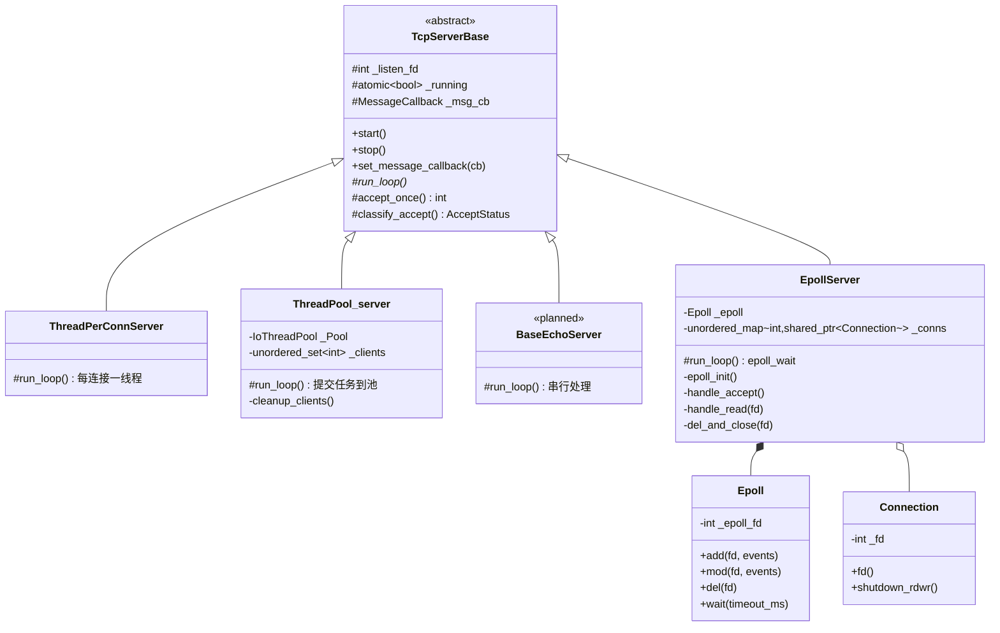

# socket_server

一个从零手写的 C++17 TCP 服务端，目标是**沿着真实工业路径，一步步把这套东西做到产品级**。

不是抄一个 muduo 就完事——每一层的坑都自己踩一遍，踩完写笔记（`note/`），
再用脚本量化验证（`test/`）。当前处于**并发模型演进**阶段：三种模型已跑通并有实测证据，
第四个（epoll / reactor）正在实现。

---

## 目录

- [一、当前进度总览](#一当前进度总览)
- [二、架构](#二架构)
- [三、目录结构](#三目录结构)
- [四、构建与运行](#四构建与运行)
- [五、并发模型](#五并发模型)
- [六、测试](#六测试)
- [七、踩坑笔记](#七踩坑笔记)
- [八、距离产品级还有多远](#八距离产品级还有多远)
- [九、Roadmap](#九roadmap)

---

## 一、当前进度总览

**代码量：约 1700 行**（`lib/` 878 + `src/` 815，不含笔记与测试脚本 +1778 行）。

### 已实现 ✅

| 模块 | 内容 |
|---|---|
| **TCP 基础封装** | `socket → SO_REUSEADDR → bind → listen → accept → recv → send → close` 全流程封装进 `TcpServerBase` |
| **模板方法骨架** | `start()` 写死固定流程，只把 `run_loop()` 留成纯虚 —— 换并发模型只改一个函数 |
| **accept 错误治理** | 五态机（`Accept / RetryNow / Backoff / Stopped / Fatal`）+ 指数退避 + 日志节流 |
| **有界阻塞队列** | `BlockingQueue<T>`：`push`（阻塞）/ `try_push` / `pop` / `try_pop` / `close`，容量在构造期校验 |
| **IO 线程池** | `IoThreadPool`：`submit` 返回 bool、`try_run_one` 让调用者线程分担、`shutdown` 用 `call_once` 幂等、worker 全异常捕获 |
| **通用线程池** | `Classical_ThreadPool`：`enqueue` 返回 `std::future`，C++17 `tuple + std::apply` 完美转发 |
| **RAII 线程** | `my_jthread`：析构自动 join，禁拷贝只可移动 |
| **RAII 连接** | `Connection`：`close()` 只出现在析构函数里，禁拷贝，`shutdown_rdwr()` 用于唤醒阻塞 recv |
| **epoll 封装** | `Epoll`：`epoll_create1` / `ctl`（`add`/`mod`/`del`）/ `wait` 三个原语，RAII + 移动语义 + 事件缓冲复用 |
| **并发模型 ①** | `ThreadPerConnServer`：一连接一线程（`detach`），用作对比基线 |
| **并发模型 ②** | `ThreadPool_server`：有界队列 + 背压（队列满 → 拒绝连接）+ 优雅关闭 |
| **并发模型 ③** | `EpollServer`：**进行中** —— `epoll_init` / `handle_accept` / `handle_read` / `del_and_close` 已实现，`handle_write` 待补 |
| **压测脚手架** | `bench_server`（`--server=thread\|pool\|Epoll` 运行时切换）+ `bench_client.py`（asyncio，失败分类） |
| **优雅关闭链路** | `SIGINT → stop() → accept 返回 EBADF → Stopped → cleanup_clients() → worker join` |
| **量化测试** | EMFILE 治理（CPU 100%→0%）、队列语义（**56 断言**）、线程池加速比（2.75x）、**线程池饿死复现** |

### 未实现 ❌

输出缓冲区（`EAGAIN` 挂起）、业务协议（粘包/拆包）、定时器、日志系统、
主从 reactor、性能压测（QPS/P99）……

完整差距分析见[第八节](#八距离产品级还有多远)。

---

## 二、架构

### 继承体系



**唯一的差异点是 `run_loop()`**。`start()` 的流程所有模型完全一致：

```
start()
  ├─ create_socket()       socket(AF_INET, SOCK_STREAM, 0)
  ├─ set_reuse_addr()      SO_REUSEADDR，解决 TIME_WAIT 端口占用
  ├─ do_bind()             bind
  ├─ do_listen()           listen(backlog)
  ├─ _running = true
  └─ run_loop()            ★ 子类决定"怎么并发"
```

### 一次连接的生命周期（线程池模型）

```
SIGINT
  │
  ▼
stop()                        [信号上下文] 只做两件异步信号安全的事
  ├─ _running = false
  └─ close(_listen_fd)
        │
        ▼
accept() 立刻返回 -1, errno = EBADF
        │
        ▼
classify_accept → Stopped
        │
        ▼
break → run_loop 末尾 cleanup_clients()   [普通线程上下文]
        ├─ 持 _mtx 遍历 _clients → shutdown(fd, SHUT_RDWR)   只叫醒
        └─ _Pool.shutdown()  → worker 排空后 join
                │
                ▼
        worker: recv 返回 0 → break → 持 _mtx → erase + close   唯一出口
```

---

## 三、目录结构

```
socket/
├── CMakeLists.txt
├── lib/                          通用组件（与业务无关）
│   ├── blocking_queue.hpp          有界阻塞队列（push / try_push / pop / try_pop / close）
│   ├── Iothread_pool.hpp           服务端专用线程池（submit / try_run_one 返回 bool）
│   ├── thread_pool.hpp             通用线程池（enqueue 返回 future）
│   ├── thread_pool_v2.hpp          线程池改进版（每线程本地队列）
│   ├── thread_safe_queue.hpp       教学版队列（未使用，保留对比）
│   ├── jthread.hpp                 RAII join 线程
│   ├── Connection.hpp              RAII 连接（close 只出现在析构里）
│   └── epoll.hpp                   epoll 三原语封装（create1 / ctl / wait）
├── src/
│   ├── main.cpp                    入口：参数解析 + 模型选择 + 信号注册
│   ├── server/
│   │   ├── tcp_server.hpp          模板方法基类
│   │   └── tcp_server.cpp          原语实现
│   ├── mthread/                    并发模型（每种模型一个文件）
│   │   ├── pthread_server.hpp        一连接一线程
│   │   ├── thread_pool_server.hpp    线程池 + 背压
│   │   └── Epoll_server.hpp          epoll / reactor（进行中）
│   └── demo/server.cpp             早期 demo（已注释，保留）
├── test/
│   ├── test_01_emfile.sh           fd 耗尽：CPU 占用 + 日志增长
│   ├── test_02_blocking_queue.sh   队列语义（56 断言，含 TSan）
│   ├── test_03_pool_starvation.sh  线程池饿死复现（3 个实验）
│   ├── blocking_queue_test.cpp    队列 + try_run_one 单元测试
│   ├── thread_pool_test.cpp        线程池加速比
│   ├── bench_server.cpp            压测专用入口（--server= 运行时切换）
│   └── bench_client.py             asyncio 压测客户端（失败分类）
└── note/                         踩坑笔记（按阶段）
    ├── note_stage1_TCP服务端踩坑.md
    ├── note_stage2_accept错误处理与fd耗尽.md
    ├── note_stage3_线程池踩坑.md
    ├── note_stage4_线程池服务端收尾与关闭踩坑.md
    └── note_stage5_为什么线程模型在高并发下失效.md
```

---

## 四、构建与运行

### 构建

```bash
cmake -S . -B build -DCMAKE_EXPORT_COMPILE_COMMANDS=ON
cmake --build build -j
```

依赖：CMake ≥ 3.16、g++ ≥ 9（C++17）、pthread。

### 运行

**方式 A：`socket_server`（手动验证，模型写死在 `src/main.cpp`）**

```bash
./build/socket_server 6003        # 端口，默认 6003
```

**方式 B：`bench_server`（压测 / 对比模型，运行时切换）**

```bash
./build/bench_server --server=thread --port=6201
./build/bench_server --server=pool   --port=6201 --workers=4 --queue-cap=1024
./build/bench_server --server=Epoll  --port=6201          # 注意首字母大写
./build/bench_server --help
```

> **二进制在 `build/` 下，不在 `test/` 下。**
> `test/bench_server.cpp` 只是源码，编译产物统一落在 `build/`。

### 验证

```bash
# 多轮 echo（-N = EOF 后立即发 FIN）
printf 'hello\nworld\nthird\n' | nc -N 127.0.0.1 6003

# 优雅退出，退出码必须是 0（不是 134）
./build/socket_server 6003 &
kill -INT $!
wait $!; echo "exit=$?"

# 用压测客户端（asyncio，2000 连接只占 1 个客户端线程）
python3 test/bench_client.py --port=6201 --mode=echo --conns=100 --msgs=10
```

---

## 五、并发模型

| 模型 | 文件 | 并发度 | 优点 | 致命缺陷 |
|---|---|---|---|---|
| **串行** | 待补（`BaseEchoServer`） | 1 | 零开销、零竞争 | 一个客户端能饿死所有人 |
| **一连接一线程** | `pthread_server.hpp` | ∞（无上限） | 实现最简单 | 1 万连接 ≈ 80GB 虚拟栈；`detach + this` = UAF；无法优雅关闭 |
| **线程池** | `thread_pool_server.hpp` | 硬上限（worker 数） | 有背压、可优雅关闭 | **阻塞 `recv` 焊死 worker**，长连接下退化成"一连接一线程 + 上限 N" |
| **epoll / reactor** | `Epoll_server.hpp`（进行中） | 万级连接 | 单线程管万连接，无线程开销 | 需要非阻塞 I/O + 状态机，复杂度陡增 |

### 三个缺陷的实测证据

`test/test_03_pool_starvation.sh` 用三个实验把线程池模型的缺陷变成可复现的数字：

| 实验 | 场景 | 实测结果 |
|---|---|---|
| **A 饿死** | `workers=2`，2 条只连不发的连接占满 worker，第 3 条发请求 | **pool：`recv=0, errors=1`（超时无响应）**；thread：`recv=3`（正常） |
| **B 队满** | `workers=1 queue-cap=1`，worker 占满 + 队列塞满，第 3 条连接 | `eof_early=1, recv=0` —— 只能踢掉新连接，无法给已有连接限流 |
| **C 线程数** | 20 条 hold 连接，数 `/proc/PID/task` | thread **21 线程** vs pool(workers=4) **5 线程** |

> 实验 A 最可怕的地方是**它完全静默**：`accept` 成功、`submit` 成功、
> fd 进了 `_clients`，没有任何错误日志，CPU 不升、内存不涨。
> 客户端只看到一个超时。这种 bug 在生产环境能活好几个月。

完整的成因分析见 [`note_stage5_为什么线程模型在高并发下失效.md`](note/note_stage5_为什么线程模型在高并发下失效.md)。

### 三种模型的核心差异：只有一处

得益于模板方法，`start()` 的流程三种模型完全一致，**唯一的接缝是 `run_loop()`**：

```cpp
// thread 模型
while (running) { accept → new std::thread(handle_client_read) → detach }

// pool 模型
while (running) { accept → _Pool.submit([]{ handle_client_read(fd); }) }

// epoll 模型
while (running) { epoll_wait → 遍历就绪事件 → handle_read(fd) }
```

差别只有 20 行，但**任务时长**差了三个数量级：

| | thread | pool（阻塞版） | epoll |
|---|---|---|---|
| 任务是什么 | 整个连接生命周期 | 整个连接生命周期 | **一次就绪事件** |
| 任务时长 | 分钟~小时 | 分钟~小时 | **微秒~毫秒** |
| worker 归还 | ❌ 不归还 | ❌ 不归还 | ✅ 每次处理完即归还 |

### 切换方式

**方式 A（当前）**：改 `src/main.cpp` 两行

```cpp
#include "mthread/thread_pool_server.hpp"   // ← 换 include
ThreadPool_server server(port);             // ← 换类型
```

**方式 B**：CMake 多个 `add_executable` + 编译期宏

**方式 C（已实现）**：运行时 `--server=thread|pool|Epoll`（`std::unique_ptr<TcpServerBase>` 分派）

```bash
./build/bench_server --server=thread --port=6201
./build/bench_server --server=pool   --port=6201 --workers=4
./build/bench_server --server=Epoll  --port=6201
```

> **注意**：`TcpServerBase` 有纯虚 `run_loop()`，**不能直接实例化**。
> 想跑串行基线必须写一个最小派生类。另外 `g_server` 必须声明成 `TcpServerBase*`，
> 否则切换模型时会编译失败。
>
> 模型名**大小写敏感**：`--server=Epoll` 可以，`--server=epoll` 会返回 exit 2。

### 线程池模型的核心认知

`ThreadPool_server` **当前不是终态**。它的 `submit` 提交的是
`handle_client_read(fd)`——一个**整个连接生命周期内不返回**的长任务。
这导致 worker 一旦被长连接占住就再也不会回到队列。

所以它的真正价值不是"提升吞吐"，而是**验证背压链路**：

```
队列满 → try_push 返回 false → 拒绝新连接（close fd）→ 客户端重连
```

要让它真正发挥威力，必须把阻塞 `recv` 换成 **非阻塞 + epoll**，让任务变成"短任务"。
这是 `Epoll_server.hpp` 正在做的事。

---

## 六、测试

### `test_01_emfile.sh` —— fd 耗尽治理

```bash
./test/test_01_emfile.sh              # 完整（编译 3 种模式）
./test/test_01_emfile.sh --no-build   # 跳过编译
```

**判据**（硬指标，不看日志文案）：

| 指标 | 采集方式 | 阈值 |
|---|---|---|
| CPU | `/proc/PID/stat` 的 `utime+stime` 差分 | < 30% |
| 日志增长 | 窗口前后 `wc -l` 差值 | < 100 行 / 2s |

**实测对比**：

| 指标 | 修复前 | 修复后 |
|---|---|---|
| CPU | **100%** | 0% |
| 日志 | 580,941 行 / 2s | 2 行 / 2s |
| 结果 | FAIL | **PASS** |

### `test_02_blocking_queue.sh` —— 队列语义与线程池契约

```bash
./test/test_02_blocking_queue.sh              # O0 + O2 + TSan 全跑
./test/test_02_blocking_queue.sh --no-tsan    # 跳过 TSan（容器里 mmap_rnd_bits=32 会报错）
./test/test_02_blocking_queue.sh --only-tsan
```

**56 个断言**，全部 PASS（O0 / O2 / TSan 三种模式）：

| 组 | 覆盖 |
|---|---|
| 1–10 | 容量校验、`push` 阻塞唤醒、`try_push` 非阻塞、`pop` 空队列、`close` 唤醒所有等待者、幂等性 |
| **11 `try_pop`** | 空队列返回 false 且**不阻塞**；连续 3 次必须拿到 3 个不同元素（**能抓住漏写 `pop_front`**）；close 后仍能排空；capacity=1 满队列时唤醒生产者（验证用的是 `_not_full` 而不是 `_not_empty`） |
| **12 `try_run_one`** | 空池立即返回 false；**用 `thread::id` 证明任务跑在调用者线程**；`while(try_run_one())` 恰好排空 20 个；任务抛异常不外泄；4 worker + 主线程抢 5000 个任务，执行次数**精确等于 5000** |

> TSan 在本容器里需要 `setarch $(uname -m) -R`（`mmap_rnd_bits=32` 与 TSan 冲突），
> `test_02` 脚本已自动处理。

### `test_03_pool_starvation.sh` —— 线程池饿死复现

```bash
./test/test_03_pool_starvation.sh
./test/test_03_pool_starvation.sh --no-build
```

三个实验（A 饿死 / B 队满 / C 线程数），判据只看**行为**不看日志文案。
完整数据见[第五节](#五并发模型)。这是"为什么必须转 reactor"的实测证据。

### `test/thread_pool_test.cpp` —— 加速比

```bash
g++ -std=c++17 -O2 -Wall -Wextra -I./lib -pthread \
    test/thread_pool_test.cpp -o test/pooltest && ./test/pooltest
```

**实测**（4 核，10 万任务）：

```
线程池总耗时 374 ms     单线程 1027 ms     加速比 2.75x
结果校验：一致 PASS
```

> 加速比 2.75x 而非 4x，说明并非纯 CPU 密集 —— 任务里含队列锁竞争。
> 这是"锁粒度"对吞吐影响的第一个量化证据。

### 退出码约定

所有脚本统一：`0 = PASS`，`1 = FAIL`，`2 = 环境/构建问题`。

---

## 七、踩坑笔记

| 文件 | 主题 | 坑数 |
|---|---|---|
| `note_stage1_TCP服务端踩坑.md` | socket 原语、参数陷阱、阻塞 I/O 本质 | 8 |
| `note_stage2_accept错误处理与fd耗尽.md` | accept 失败治理、忙等自旋、fd 泄漏 | 8 |
| `note_stage3_线程池踩坑.md` | 队列/线程池实现、编译期与并发正确性 | 18 |
| `note_stage4_线程池服务端收尾与关闭踩坑.md` | 连接收尾、优雅关闭、信号安全、模型切换 | 8 |
| `note_stage5_为什么线程模型在高并发下失效.md` | **架构转折**：thread → reactor 的完整推导与实测证据 | — |

**几条最贵的教训**（都付了实测代价）：

1. `std::function<void>` 少了 `()` —— 一个拼写引起 10 个连锁错误
2. `accept()` 里 `perror` + `continue` = CPU 100% + 每秒 30 万行日志
3. `submit` 用阻塞 `push` —— accept 循环卡死 2 秒，**为防过载造成更严重过载**
4. `catch(const std::exception&)` **抓不住 `throw 42`** —— 整个进程 `terminate`
5. 收尾块写进 `while` 循环体 —— 同时造成"提前 close"和"永不 close"两种相反 bug
6. `accept_once` 里 `throw` —— 精心设计的五态机完全跑不到，Ctrl+C 变退出码 134
7. `cleanup_clients` 放进 `stop()` —— 信号上下文里 `mutex::lock` = 死锁
8. `close` 唤不醒阻塞的 `recv` —— 必须 `shutdown(SHUT_RDWR)`
9. `try_pop` 里 `std::move(front())` 后**忘了 `pop_front()`** —— 同一个任务被反复执行，
   `size()` 永不减少，第二次执行碰到 moved-from 的 `std::function` 直接 `bad_function_call`
10. `try_pop` 里 `if(empty()){}` 空函数体 —— 对空 deque 调 `front()` 是 UB，
    且永远返回 `true`
11. `del_and_close` 里 `_conns.erase(fd)`（内部 `close`）写在 `epoll.del(fd)` **之前** ——
    fd 被内核回收后立刻被新连接复用，删掉的是**新连接**的监视，新连接静默失效

---

## 八、距离产品级还有多远

**先给结论：当前大约完成了产品级服务器工作量的 10~15%（按功能面算，不按代码量）。**

真正的判断标准不是"能跑通 echo"，而是**能否在故障、过载、攻击、长期运行下保持正确**。
下面按"能不能上线"逐层拆。

### 差距分级

#### 🔴 P0 —— 不解决就不能叫"服务器"

| 差距 | 现状 | 产品级要求 | 代价 |
|---|---|---|---|
| **事件驱动** | 无，阻塞 I/O | epoll + **非阻塞** + 状态机 | 需重写 `run_loop`，约 500 行 |
| **协议层** | 无（echo 原始字节流） | 长度头 / 分隔符 + 粘包拆包 + 单条消息上限 | 约 300 行 + 状态机 |
| **写路径处理** | `send` 不考虑部分写 | 输出缓冲区 + `EAGAIN` 挂起 + 可写事件回调 | 约 200 行，**最容易漏** |
| **连接超时** | 无 | 定时器（时间轮 / 小根堆）+ 空闲断开 | 约 200 行 |
| **日志系统** | `std::cout` / `std::cerr` | 分级、异步、滚动、可关 | 约 200 行 |

> **`send` 的部分写是当前最大的隐藏炸弹。**
> 现在的 echo 回调里 `while (sent < len) send(...)`，一旦 socket 发送缓冲区满
> 且 socket 是非阻塞的，就会 `EAGAIN` → 你的循环会 `return`（当前代码是 `return`）
> → **这条消息的后半段永久丢失**。
> 只是因为现在是阻塞 socket 才没暴露。换成非阻塞的瞬间就会炸。

#### 🟠 P1 —— 竞品都有，没有就被比下去

| 差距 | 说明 |
|---|---|
| **主从 reactor** | one loop per thread：主线程 accept，从线程各自 epoll 一组连接 |
| **连接对象化** | `_clients` 换成 `shared_ptr<Connection>` + 引用计数，去掉全局锁 |
| **TCP 调优** | `TCP_NODELAY`（关 Nagle）、`SO_KEEPALIVE`、`SO_LINGER` |
| **半关闭支持** | `shutdown(SHUT_WR)` 后仍能读，处理 `CLOSE_WAIT` |
| **背压（连接级）** | 不只拒绝新连接，还要对**已有连接**限流（读端暂停） |
| **统计指标** | QPS、P50/P99 延迟、活跃连接数、拒绝数、队列水位 |
| **配置化** | 端口/worker 数/队列容量/超时时间从配置文件读，不重新编译 |

#### 🟡 P2 —— 生产环境必需

| 差距 | 说明 |
|---|---|
| **内存管理** | 小对象池、`readv/writev` 聚合写、`sendfile` 零拷贝 |
| **信号处理** | 当前 `std::signal` 粗糙；生产用 `signalfd` 或 self-pipe，统一进事件循环 |
| **优雅重启** | `SO_REUSEPORT` + 新旧进程交接，不断连接地升级 |
| **限流 / 黑名单** | 单 IP 连接数上限、速率限制、慢连接攻击防护 |
| **崩溃可观测** | core dump、backtrace、`perf` / `gperftools` 火焰图 |
| **压力测试** | 自研压测客户端（连接数 / QPS / 延迟分布），当前完全没有 |
| **CI** | 编译矩阵（gcc/clang × O0/O2/TSan/ASan）、回归测试自动化 |

#### ⚪ P3 —— 特定场景才需要

TLS（OpenSSL）、HTTP/2、IPv6 dual-stack、`io_uring`、DPDK、多进程模型（nginx 那种）。

### 量化对比

| 项目 | 代码量 | 说明 |
|---|---|---|
| **本项目** | ~1,700 行 | 四种并发模型（其四进行中）+ 队列 + 线程池 + epoll 封装 |
| muduo（陈硕） | ~10,000 行 | 主从 reactor + 定时器 + 日志 + 协议 |
| libevent | ~30,000 行 | 跨平台事件循环 + bufferevent |
| nginx（核心网络） | ~150,000 行 | 多进程 + 全异步 + 极致调优 |

**但代码量不是重点。** 差距的本质是：

> 本项目验证的是"**我知道每个坑在哪**"；
> 产品级要求的是"**我在任何异常路径上都不会崩、不漏、不卡**"。

前者是知识，后者是**覆盖面**。覆盖面的实现靠的是把每一个
`EAGAIN` / `EINTR` / `EMFILE` / 部分写 / 半关闭 / 超时 / 惊群
都变成一条被测过的分支。

### 当前代码里已知的具体缺陷

这些不是"未来要做的功能"，是**现在就有、只是还没被触发**的问题：

| # | 缺陷 | 触发条件 | 严重度 |
|---|---|---|---|
| 1 | `send` 遇 `EAGAIN` 直接 `return`，消息后半段丢失 | 非阻塞 socket + 发送缓冲满 | 🔴 |
| 2 | `EpollServer::handle_write` 是空壳，`EPOLLOUT` 未注册也没处理 | 需要非阻塞写的那一天 | 🔴 |
| 3 | `EpollServer` 里 `_epfd` 成员已废弃但析构仍在 `close(_epfd)`（恒为 -1，无害但误导） | — | ⚪ |
| 4 | `ThreadPool_server` 无 `Fatal` 连续次数上限，永久错误会无限退避 | listen fd 损坏 | 🟠 |
| 5 | `_listen_fd` 非原子，`stop()` 与析构可能双重 `close` | 多线程/信号交错 | 🟠 |
| 6 | 阻塞 `recv` 焊死 worker，线程池退化成"一连接一线程 + 上限" | 长连接 | 🟠 |
| 7 | `listen(fd, 5)` backlog 过小 | 高并发建连 | 🟡 |
| 8 | 全局 `_mtx` 保护连接表，worker 数一多就是瓶颈 | worker > 32 | 🟡 |
| 9 | `_idle_fd` 预留机制定义了但没启用 | EMFILE | 🟡 |
| 10 | 无连接数上限、无空闲超时 → slowloris / 连接耗尽 | 公网暴露 | 🟠 |
| 11 | `test/pooltest`、`test/bq_*` 二进制被提交进仓库 | — | ⚪ |

---

## 九、Roadmap

### 阶段 5：事件驱动（进行中 🚧）

- [x] `Epoll` 封装：`epoll_create1` + `epoll_ctl` + `epoll_wait`
- [x] `Connection` RAII：`close()` 只在析构里，`shutdown_rdwr()` 唤醒阻塞 recv
- [x] `epoll_init()` / `add` 注册监听 fd
- [x] `handle_accept()`：`accept4(SOCK_NONBLOCK)` 循环 + `EAGAIN`/`EMFILE` 分支
- [x] `handle_read()`：非阻塞 recv 循环，读到 `EAGAIN` 才返回
- [x] `del_and_close()`：**先 `epoll.del` 再 `erase`**（顺序错了会静默失效）
- [x] `bench_server --server=Epoll` 运行时切换 + `bench_client.py` 失败分类
- [ ] `run_loop()` 主循环联调打通（当前 `accept4: Bad file descriptor`）
- [ ] **写路径**：输出缓冲区 + `EAGAIN` 挂起 + `EPOLLOUT` + `handle_write`
- [ ] `IoThreadPool::try_run_one()` 接回 reactor 空闲间隙
- [ ] `BaseEchoServer` —— 串行基线，补齐对比模型
- [ ] 对比四种模型的 QPS / P99 延迟

### 阶段 6：协议与连接管理

- [ ] 长度头协议（4 字节大端长度 + payload）
- [ ] 粘包 / 拆包状态机
- [ ] `Connection` 对象化（`shared_ptr` + 引用计数）
- [ ] 单条消息上限（防内存炸弹）

### 阶段 7：时间与超时

- [ ] 定时器（时间轮 or 小根堆）
- [ ] 空闲连接自动断开
- [ ] `SO_KEEPALIVE` + `TCP_NODELAY`

### 阶段 8：工程化

- [ ] 异步日志系统
- [ ] 配置文件
- [ ] 自研压测客户端（连接数 / QPS / P50 P99）
- [ ] CI：gcc/clang × O0/O2/TSan/ASan 编译矩阵

### 阶段 9：生产加固

- [ ] 主从 reactor（one loop per thread）
- [ ] `SO_REUSEPORT` 优雅重启
- [ ] 限流 / 黑名单
- [ ] 内存池 + `sendfile` 零拷贝

---

## License

个人学习项目，无 License。
笔记与代码中的错误欢迎指正。