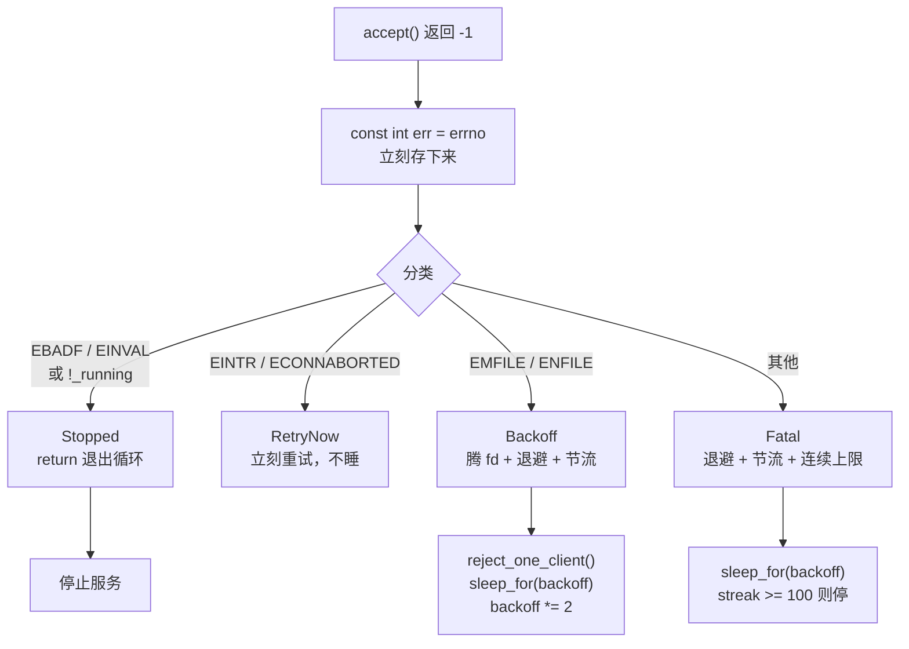
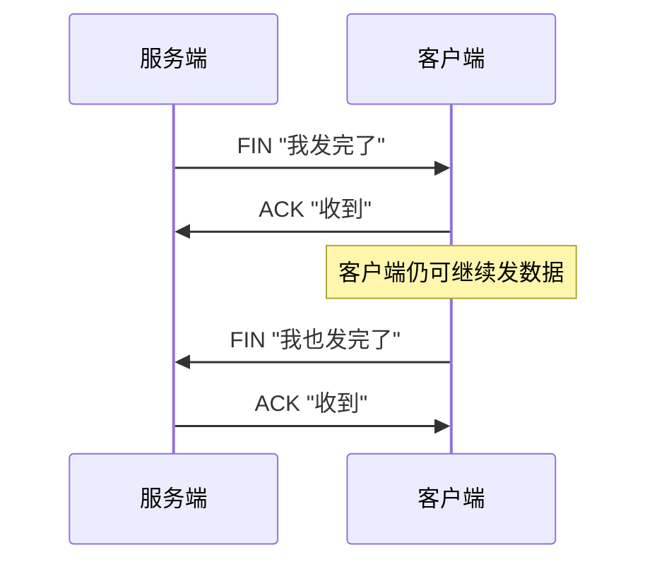
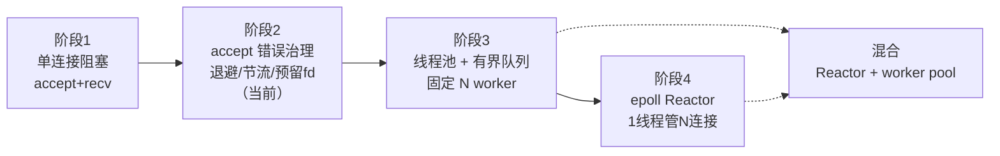

# 阶段2：accept 错误处理 + fd 耗尽治理 —— 踩坑笔记

对应流程：`accept() 失败 -> errno 分类 -> 退避/节流/预留 fd -> 恢复`

本篇记录 `ThreadPerConnServer` 从"一遇 fd 耗尽就空转烧 CPU"到"能优雅扛住"的全过程，
包括原始代码的每处缺陷、`test/test_01_emfile.sh` 失败的根因、修复方案，以及几个
"为什么必须这么写"的原理总结。

***

## 一、修复前的真实数据

用 `test/test_01_emfile.sh`（`ulimit -n 24`，40 个客户端）测原始版本：

| 指标 | 修复前 | 修复后 |
|---|---|---|
| CPU 占用 | **100%** | **0%** |
| 2 秒内日志增长 | **58 万行** | **2 行** |
| accept 失败日志累计 | 96 万条 | 0 条（已节流） |
| 测试结果 | FAIL | **PASS** |

测试输出对比：

```
# 修复前
[3/5] CPU        : 100%   （判据 < 30%）
      日志增长   : 580941 行 / 2s   ≈ 290470 行/秒   （判据 < 100 行）
[4/5] ✗ CPU 100% —— accept 失败后立即重试，忙等自旋
      ✗ 日志 580941 行/2s —— perror 无节流，日志洪水
结果: FAIL

# 修复后
[3/5] CPU        : 0%
      日志增长   : 2 行 / 2s   ≈ 1 行/秒
[4/5] ✓ PASS：accept 失败后有退避，没有自旋
结果: PASS
```

***

## 二、原始代码的 8 个问题

### 问题 1（最严重）：accept 失败后忙等自旋

```cpp
// 原始 run_loop
while(_running){
    sockaddr_in client_addr;
    int client_fd = accept_once(client_addr);
    if  (client_fd < 0) continue;        // ← 立即重试
    ...
}

// 原始 accept_once
int TcpServerBase::accept_once(struct sockaddr_in &server_addr){
    socklen_t len = sizeof(server_addr);
    int accept_res = accept(_listen_fd, (struct sockaddr *)&server_addr,&len);
    if(accept_res < 0) {
        perror("accept failed");         // ← 每次失败都打日志
    }
    return accept_res;
}
```

**故障链**：fd 表满 → `accept` 返回 -1（`errno=EMFILE`）→ `perror` 打一行 →
`continue` 立即重试 → 又失败 → 又打一行……

结果是 **CPU 100% + 每秒 30 万行日志**（实测 58 万行/2秒）。

而且 `accept` 是**非阻塞的失败**（不是等不到连接，是内核立刻告诉你"给不了 fd"），
所以这个循环没有任何喘息，纯粹在烧 CPU。

### 问题 2：用返回值混淆了"错误码"和"errno"

```cpp
if(client_fd == EMFILE){      // ← 永远不成立
```

`accept()` 失败时**返回值恒为 -1**。`EMFILE` 是 `errno` 的值，不是返回值。
这两个是**独立的信息源**，混成一个 `int` 就必然写错。

这是"返回值信息量不足"的典型症状：`int` 只能表达"成功/失败"，但调用方需要知道
**接下来该干什么**（重试？退避？退出？），所以要换成状态枚举。

### 问题 3：EMFILE 只改了日志文案，没改行为

中间版本曾这样改过：

```cpp
if (errno == EMFILE ){
    perror("fd is tryed ,please check out your memory or close invalid connect");
    return -1;                    // ← 仍然是 -1，run_loop 仍然 continue
}
```

**换文案不改变控制流**。测试照样 FAIL——判据是 CPU 和日志增长率，不看日志写了什么。

### 问题 4：`EMFILE` 时客户端陷入"半死连接"

不睡眠、不腾 fd，只是 `continue`，那么已经完成三次握手的客户端会怎样？

客户端视角：`connect()` 成功 → `send()` 成功 → `recv()` **一直卡住**。

实测（fd 灌满后再连一个）：

```
=== fd 已满，再连一个 ==="
exception: timed out      耗时 5.01s     ← 卡满 5 秒超时
```

因为内核 `accept` 的流程是：

```
1. 从 accept 队列取一个已完成握手的连接   ← 这一步已经成功了
2. 为它分配一个 fd                        ← 这一步因 fd 满而失败 → EMFILE
```

连接**还躺在队列里没被丢弃**，客户端却永远等不到服务。这比明确拒绝更糟。

### 问题 5：`_running` 不是原子变量（数据竞争）

```cpp
bool _running;      // 信号处理函数写、accept 循环读、工作线程读
```

`on_signal()`（信号上下文）写、`run_loop()` 读、`client_thread_func()` 读，
三个执行流无同步地访问同一个 `bool` —— **未定义行为**。编译器还可能把
`while(_running)` 优化成只读一次。

已改为 `std::atomic<bool> _running;`。

### 问题 6：`_listen_fd` / `_idle_fd` 不是原子变量（双重 close）

```cpp
void stop(){
    _running = false;
    if(_listen_fd >= 0){ close(_listen_fd); _listen_fd = -1; }   // 三步非原子
}
```

`stop()` 会被两个地方调用：

1. `on_signal()` —— 信号处理函数
2. `~TcpServerBase()` —— 主线程

两者交错时可能 `close` 同一个 fd 两次。**第二次 close 时那个号可能已经被
`accept` 复用成新的客户端连接了** —— 你等于顺手把别人的连接关了，堪称灾难。

> 当前代码里已有注释标注这一点，计划在多线程章节后改成 `std::atomic<int>` +
> `exchange(-1)`。

### 问题 7：`reserve_idle_fd()` 定义了但从未调用

```bash
$ grep -rn "reserve_idle_fd" src/
src/server/tcp_server.hpp:76:    void reserve_idle_fd();          ← 只有声明
src/server/tcp_server.cpp:89:void TcpServerBase::reserve_idle_fd(){ ← 只有定义
```

没有调用点 → `_idle_fd` 永远是 `-1` → `reject_one_client()` 第 ① 步
`if (_idle_fd >= 0)` 直接跳过 → 什么都没腾出来 → 后面的 `accept` 依然 EMFILE。

**整个预留 fd 机制完全失效**，但编译不会报错，测试也看不出（只有手工验证时
才会发现客户端仍然卡 5 秒）。

**已在 `start()` 里补上调用**：

```cpp
void start(){
    create_socket();
    reserve_idle_fd();       // ★ 占坑，越早越好
    set_reuse_addr();
    do_bind();
    do_listen();
    _running = true;
    run_loop();
}
```

`stop()` 里也补了 `close(_idle_fd)`，否则退出时 fd 泄漏。

### 问题 8：`Fatal` 分支不该调 `reject_one_client()`，且没有上限

```cpp
}else if (res_fd.status == AcceptStatus::Fatal){
    ...
    reject_one_client();     // ← 这里不该调
```

`reject_one_client` 只在 **EMFILE（fd 表满）** 时有意义。`Fatal` 时腾出的位置会
立刻被同一个错误吃掉，纯浪费。

更严重的是**没有连续次数上限**：像 `ENOTSOCK`（监听 fd 已被误关）这种永久错误，
会永远退避循环，服务看似"活着"实则已死。

建议：

```cpp
unsigned int fatal_streak = 0;              // 连续 Fatal 次数
constexpr unsigned int kFatalMaxStreak = 100;

// Fatal 分支
++fatal_streak;
if (fatal_streak >= kFatalMaxStreak){
    std::cerr << "[accept] 连续 " << fatal_streak
              << " 次未知错误，监听套接字可能已损坏，停止服务" << std::endl;
    _running = false;
    return;
}
// Accept / RetryNow 分支里 fatal_streak = 0;
```

关键：**`fatal_streak` 必须和 `err_count` 分开计数**。EMFILE 是可恢复的，
如果它也把 `fatal_streak` 堆到 100，正常的 fd 耗尽就会把服务干停。

***

## 三、`test_01_emfile.sh` 为什么测不过

### 判据是什么

脚本不看你说什么，只看两个**硬指标**：

| 指标 | 采集方式 | 判据 |
|---|---|---|
| CPU | `/proc/PID/stat` 的 `utime+stime`（jiffies）前后差分 ÷ (窗口 × `CLK_TCK`) | < 30% |
| 日志增长率 | 窗口前后 `wc -l` 差值 | < 100 行/2s |

### 还有一个前置断言

脚本必须先在日志里看到 `Too many open files`，否则说明 **fd 根本没耗尽**，
测试无效，直接以退出码 2 结束并提示调参数。这避免了"假 PASS"。

### 失败的直接原因

1. **CPU 100%**：`accept` 失败后 `continue` 立即重试，无任何等待
2. **日志 58 万行/2s**：`perror` 每次失败都打，无节流

这两条**互为因果**：自旋导致高频失败，高频失败导致日志洪水。

### 脚本本身的几个实现坑（写测试时会遇到）

| 处理 | 原因 |
|---|---|
| `( ulimit -n 24; exec "$BIN" ) &` | `ulimit` 只影响当前 shell；子 shell + `exec` 才能保证 pid 就是服务端 |
| 用 `ss -ltn` 等端口就绪 | 不用 `nc` 探测，避免探测连接自己占掉一个 fd、干扰计数 |
| `ls -l /proc/PID/fd \| grep -c 'socket:'` | 直接数 fd 总数会把 bash 经 `exec` 继承的高位 fd 算进去，出现"27 > 上限 24"的假矛盾 |
| `kill` 后 `wait` | 否则 bash 打印 `Killed` 作业通知，污染输出 |
| `trap cleanup EXIT INT TERM` | Ctrl+C 中断时也能收尸，不留僵尸进程 |

> 实测踩到的假矛盾：`服务端已打开 fd 数: 27 / 上限 24`。原因是 bash 自己的
> 高位 fd（25/28/29）通过 `exec` 被继承进来。改成只数 `socket:` 类型就正常了。

***

## 四、修复方案总览



### 核心设计：返回"状态"而不是"int"

```cpp
enum class AcceptStatus{
    Accept,      // 成功，fd 有效
    RetryNow,    // 立刻重试：EINTR / ECONNABORTED
    Backoff,     // 需要退避：EMFILE / ENFILE
    Stopped,     // 已停止：EBADF / EINVAL / !_running → 退出循环
    Fatal        // 未知错误：退避 + 节流，连续太多次则停
};

struct AcceptOutCome{
    AcceptStatus status;
    int fd;      // 仅 Accept 时有效
    int err;     // 出错时的 errno，用于日志
};
```

**职责分离**：`accept_once()` 只做"errno → 状态"的翻译，**不做策略、不打日志**。
睡眠、日志、腾 fd 全部放在 `run_loop()` 里——因为只有那一层能跨调用保持状态
（退避时长、日志时间戳、计数器）。

### 表驱动式的分支语义

| 状态 | errno | 调用方该做什么 |
|---|---|---|
| `Accept` | — | 重置退避和计数，起线程 |
| `RetryNow` | `EINTR`、`ECONNABORTED` | 立刻 `continue`，正常情况不睡 |
| `Backoff` | `EMFILE`、`ENFILE` | 腾 fd + 退避 + 节流日志 |
| `Stopped` | `EBADF`、`EINVAL` | `return` 退出（不是 `continue`） |
| `Fatal` | 其他 | 退避 + 节流 + 连续上限 |

> `Stopped` 必须用 `return` 而非 `break`。`break` 只跳出 `switch`，还在
> `while(_running)` 里，要等下一轮才退。

### 一个必须记住的细节

```cpp
const int err = errno;   // ★ 必须在 accept 返回后第一行
```

`perror`、`std::cerr`、`strerror` **都可能改写 `errno`**。晚一步读就是错的。

***

## 五、专题总结

### 专题 1：预留 fd（idle fd）—— 为什么是 `open("/dev/null")` 而不是 accept

#### 先理解 fd 表

进程的 fd 就是一张**数组**，下标就是"位置"：

```
下标:   0      1      2      3        4      5    ...   1023
       stdin  stdout stderr listen  客户端A  客户端B      空闲
```

`open()` / `socket()` / `accept()` 做的事都是：**找一个空闲下标，返回它**。
`ulimit -n 24` 意味着这张表最多到下标 23。**表满 → accept 返回 EMFILE**。

#### 预留 = 提前占住一个坑

启动时 `open("/dev/null")` 拿一个下标（比如 20）：

```
下标:   ...   18     19     20        21   22   23
              conn   conn   /dev/null  满   满   满
                             ↑
                        这是"备胎"
```

这个 `/dev/null` **没有任何业务用途**，唯一作用是在表里占位，
让你手里始终握着"一张可以随时扔出的牌"。

#### 完整流程

```
① close(_idle_fd)        ← 主动腾出下标 20
② accept()               ← 必定成功，拿到下标 20
③ close(刚拿到的 fd)      ← 客户端立刻收到 FIN
④ open("/dev/null")      ← 重新占坑，为下次准备
⑤ sleep_for(backoff)     ← 等已有连接释放 fd
```

#### 为什么第 ② 步一定成功、且不会阻塞

因为 EMFILE 时那个客户端的连接**已经在 accept 队列里了**（见问题 4 的说明）。
`accept` 的第 1 步（取连接）早就成功，只是第 2 步（分配 fd）失败。
你腾出位置再 accept，正好把它捞出来。

#### 为什么第 ③ 步必须 close

| 做法 | 客户端感受 |
|---|---|
| 不 accept，直接 continue | 客户端以为连上了，发数据，**永远等不到响应**，只能超时 |
| accept 后立刻 close | `recv()` **立刻**返回 `0`，明确知道被拒 |

这就是"半死连接"和"明确拒绝"的区别。

想更强制地拒绝（发 RST 而不是 FIN），`close` 前加：

```cpp
struct linger lg{1, 0};    // l_onoff=1, l_linger=0
setsockopt(fd, SOL_SOCKET, SO_LINGER, &lg, sizeof(lg));
```

#### 为什么不能"关掉一个已有客户端的 fd"来腾位置

- 你不知道哪个连接"不重要"，无故断开正在服务的连接是错误行为
- 关掉别人在用的 fd，那个线程的 `recv` 会立刻 `EBADF`，逻辑全乱
- `_idle_fd` 是**你自己专门准备的**，关它没有任何副作用

#### 注意事项

| 点 | 说明 |
|---|---|
| `O_CLOEXEC` | `fork`+`exec` 出的子进程不会继承，避免泄漏（项目里有 `fork_server.hpp`，迟早会踩） |
| 第 ④ 步可能失败 | 刚腾的坑可能被别的线程抢走，`open` 返回 -1 是正常的，允许 `_idle_fd == -1` |
| `stop()` 里要 close | 否则退出时泄漏 |
| `reserve_idle_fd()` 必须在 `start()` 调用 | 忘了调用 = 整个机制静默失效（问题 7 就是） |
| 占 1 个 fd | `ulimit -n 24` 时实际可用连接少 1 个，测试判据要能容忍 |

### 专题 2：日志节流（throttle）

#### 原理

**同一类日志 1 秒内最多打 1 条**，同时报告"累计多少次"，信息量不丢。

```cpp
auto     last_log = std::chrono::steady_clock::now() - std::chrono::seconds(5);
unsigned int err_count = 0;

// 出错时
++err_count;
const auto now = std::chrono::steady_clock::now();
if (now - last_log >= std::chrono::seconds(1)){
    std::cerr << "[accept]" << std::strerror(res_fd.err)
              << " accumulate:" << err_count
              << " backoff:" << backoff.count() << std::endl;
    last_log = now;
}
```

`now() - seconds(5)` 的技巧是**保证第一条日志一定打出来**，不用额外写"是否是第一次"
的判断。

#### 为什么必须用 `steady_clock`

| 时钟 | 特性 | 能否用于测时间差 |
|---|---|---|
| `steady_clock` | **单调递增**，不受系统时间调整影响 | ✅ 正确选择 |
| `system_clock` | 可被 NTP 校时、闰秒调整，**可能倒退** | ❌ 差值为负 → 日志疯狂刷 |

这是新手很常见的坑：用 `system_clock` 算 `now - last >= 1s`，在某次时间同步后
`now < last`，条件恒为 false，节流彻底失效。

#### 恢复时打汇总

```cpp
// Accept 分支
if (err_count > 0){
    std::cerr << "[accept] recovered,this error count = " << err_count << std::endl;
}
err_count = 0;
```

这样既不会刷屏，故障期有多少错误也一目了然。

#### 效果实测

```
# 修复前（无节流）
日志增长: 580941 行 / 2s

# 修复后（1 秒 1 条 + 指数退避 800ms）
日志增长: 2 行 / 2s

# 实际日志
[accept]Too many open files accumulate:1 backoff:100
[accept]Too many open files accumulate:5 backoff:800
```

### 专题 3：指数退避（backoff）

#### 原理

`EMFILE` 是"**此刻**腾不出 fd"，不是"永远腾不出"。已有客户端断开后 fd 会还回来，
所以"等一会儿再试"是正确的策略。

```cpp
const auto kBackoffMin = std::chrono::milliseconds(100);
const auto kBackoffMax = std::chrono::milliseconds(800);
std::chrono::milliseconds backoff = kBackoffMin;

// 出错时
std::this_thread::sleep_for(backoff);
backoff = std::min(backoff * 2, kBackoffMax);   // 100 → 200 → 400 → 800 → 800...

// 成功时（★ 必须有）
backoff = kBackoffMin;
```

#### 为什么成功时必须重置

不重置的话，下次一遇到 EMFILE 就直接睡 800ms，响应变慢且无必要。
**退避长度应该反映"当前连续失败的次数"，而不是历史总失败次数。**

#### 三个"不要"

| 不要 | 原因 |
|---|---|
| `usleep()` | POSIX 已废弃。用 `std::this_thread::sleep_for` 或 `nanosleep` |
| 固定时长 | 无法自适应。指数增长能让持续故障自然降频 |
| 睡太久（如 `sleep(10)`） | `stop()` 之后要尽快退出，睡眠粒度太大导致关闭延迟 |

#### 一个笔误要小心

```cpp
std::chrono::milliseconds backoff;              // ← 默认构造 = 0ms
std::this_thread::sleep_for(backoff);           // ← 睡 0ms，等于没睡

std::chrono::milliseconds backoff = kBackoffMin; // ✅ 正确
```

### 专题 4：为什么 `_running` 必须是原子变量

#### 谁在访问它

| 访问者 | 操作 | 上下文 |
|---|---|---|
| `on_signal()` | 写 `false` | **信号处理函数** |
| `run_loop()` | 读（`while(_running)`） | 主线程 |
| `client_thread_func()` | 读（`while(_running)`） | 每个工作线程 |
| `stop()` | 写 `false` | 信号 或 主线程 |

#### 普通 `bool` 的三个问题

1. **数据竞争 = 未定义行为**（C++ 标准明文规定）
2. **编译器可能把 `while(_running)` 优化成只读一次的无限循环**——因为它看不到
   另一个线程会改它
3. 即使能读到，`false` 的写入可能对其他核不可见（缓存未刷新）

`std::atomic<bool>` 同时解决可见性和顺序问题，且 `load`/`store` 在多数平台
是**单条指令**，开销可忽略。

#### 信号处理函数里的额外约束

`on_signal` 里**只能调用异步信号安全的函数**：

| 安全 ✅ | 不安全 ❌ |
|---|---|
| `close()` | `printf` / `std::cout` / `perror` |
| `write()` | `malloc` / `free` / `new` / `delete` |
| `_exit()` | `std::mutex::lock` |
| atomic 的 `store`/`load` | 任何加锁操作 |

原因：信号可能**正好打断主线程在 `malloc` 或 `cout` 锁里**，你在 handler 里再用
同样的东西就会死锁或破坏堆。

这也是为什么 `stop()` 只能做 `_running=false` + `close(fd)`——这两件事恰好都是安全的。

#### 一个容易忽略的点

`std::atomic<bool>` 的 `operator bool` 转换是 `load()`，所以 `while(_running)` 等价于
`while(_running.load())`，**每次循环都会真正读一次内存**，一定能看到更新。

### 专题 5：为什么 `_listen_fd` / `_idle_fd` 也需要原子操作

`_running` 改成 atomic 后，`_listen_fd` 还是普通 `int`：

```cpp
void stop(){
    _running = false;
    if(_listen_fd >= 0){ close(_listen_fd); _listen_fd = -1; }   // 三步非原子
}
```

#### 竞态窗口

```
时间 → 
线程 A（信号）:  if (_listen_fd >= 0)  true
线程 B（析构）:  if (_listen_fd >= 0)  true
线程 A:          close(_listen_fd)     ← 关掉 fd 4
线程 B:          close(_listen_fd)     ← 再关 fd 4 !!
线程 A:          _listen_fd = -1
线程 B:          _listen_fd = -1
```

#### 为什么"关两次"是灾难

`close()` 之后 fd 号**立刻被释放**，可以马上被下一次 `accept()` / `open()` 复用。

```
T1: close(4)           → fd 4 空闲
T2: accept() 返回 4    → fd 4 现在是某个客户端的连接！
T1: close(4)           → 把这个无辜客户端的连接关掉了 💀
```

而且这个问题**极难复现**，只在特定时序下触发。

#### 解法：原子 exchange

```cpp
// tcp_server.hpp
std::atomic<int> _listen_fd;
std::atomic<int> _idle_fd;

// tcp_server.cpp
void TcpServerBase::stop(){
    _running = false;

    int lfd = _listen_fd.exchange(-1);    // 只有一个线程能拿到旧值
    if (lfd >= 0) ::close(lfd);

    int ifd = _idle_fd.exchange(-1);
    if (ifd >= 0) ::close(ifd);
}
```

`exchange` 是**原子的"读并写"**：两个线程同时调用，只有一个返回旧 fd（`>= 0`），
另一个返回 `-1`（跳过 close）。问题从"概率性崩溃"变成"确定正确"。

#### 为什么这里不能用 mutex

```cpp
std::lock_guard<std::mutex> lk(_mtx);   // ❌ 在信号处理函数里会死锁
```

信号可能正好打断**已经持有该 mutex 的线程**，handler 里再去 lock 同一把锁就永久阻塞。
所以信号处理路径只能用**无锁的原子操作**。

> 补充：`close()` 本身是 async-signal-safe 的，所以 `exchange + close` 这套组合
> 在信号处理函数里是合法的。

### 专题 6：`close()` vs `shutdown()`

两者都会发 FIN，但语义差别很大：

| | `close(fd)` | `shutdown(fd, SHUT_WR)` |
|---|---|---|
| 发 FIN | ✅ | ✅ |
| **释放 fd 号** | ✅ 立刻释放 | ❌ 不释放，还能继续 `recv` |
| 有线程阻塞在 `recv` | 行为不可靠（fd 复用后更危险） | 安全，`recv` 返回 0 |
| 支持半关闭 | ❌ | ✅ 只关一个方向 |

使用场景：

- **`reject_one_client()` 里用 `close()`** —— fd 不用了，赶紧释放
- **`stop()` 唤醒阻塞的 worker 用 `shutdown(fd, SHUT_RDWR)`** —— fd 还被别的线程持有

### 专题 7：FIN 是什么，以及"客户端收到 FIN"意味着什么

**FIN = Finish**，TCP 头里的一个控制标志位，语义是：

> "我这边的数据发完了，不会再给你发任何东西了。"

TCP 是全双工的，两个方向的数据流**互相独立**，所以关闭也必须**两个方向分别关**。
这就是为什么关闭要**四次挥手**：



#### 客户端怎么"知道"收到 FIN

**不会收到任何错误，而是 `recv()` 返回 0**。

```cpp
ssize_t n = recv(fd, buf, sizeof(buf), 0);
if (n == 0) {
    // 对端发来 FIN，不是错误！
    // client_thread_func 就是在这里 break 的
}
```

三种返回值必须分清：

| `recv()` 返回 | 含义 | 处理 |
|---|---|---|
| `> 0` | 读到 n 字节 | 正常处理 |
| `== 0` | **对端 FIN**（有序关闭） | `break` 退出循环 |
| `< 0` | 出错 | 看 `errno`（`EINTR` 重试、`ECONNRESET` 异常断开） |

> `recv` 返回 0 **永远**表示对端有序关闭，绝不会在"暂时没数据"时返回 0
> （那是阻塞等待，不返回）。

#### 对照 `reject_one_client()`

```cpp
int fd = ::accept(...);    // ② 拿到客户端
::close(fd);               // ③ close 会触发内核发出 FIN
```

客户端体验：

```python
s = socket.create_connection(('127.0.0.1', 6101))   # 连接成功！
s.sendall(b'hello')                                 # 发送成功（进内核缓冲）
print(s.recv(100))                                  # → b'' 立刻返回
```

关键是"**立刻**"：客户端不会卡在 `recv` 上等超时。

### 专题 8：`accept` 的 errno 全表

| errno | 含义 | 分类 | 处理 |
|---|---|---|---|
| — | 成功 | `Accept` | 起线程 |
| `EINTR` | 被信号打断 | `RetryNow` | 立刻重试 |
| `ECONNABORTED` | 客户端握手前放弃 | `RetryNow` | 立刻重试 |
| `EMFILE` | **进程** fd 用光 | `Backoff` | 腾 fd + 退避 |
| `ENFILE` | **系统级**文件表满 | `Backoff` | 腾 fd + 退避 |
| `EBADF` | fd 无效（已被 close） | `Stopped` | 退出循环 |
| `EINVAL` | socket 未监听 / 参数错 | `Stopped` | 退出循环 |
| `EPERM` | 防火墙在内核层拦截 | `Fatal` | 退避 + 节流 |
| `ENOBUFS` / `ENOMEM` | 内核内存不足 | `Fatal` | 退避 + 节流 |
| `ENOTSOCK` | fd 已不是 socket | `Fatal` | 连续太多次则停 |

注意 `EMFILE` 和 `ENFILE` 的区别：前者是**你的进程** fd 表满（`ulimit -n`），
后者是**整个系统**的打开文件数达到上限（`/proc/sys/fs/file-max`）。两者都要退避，
但 `ENFILE` 你无法通过关闭自己的 fd 解决。

***

## 六、当前方案还剩哪些不足

先明确这一阶段**只解决了什么**：

> ✅ 解决了 `accept()` 失败之后的**行为**：不再自旋、不再刷日志、不再让客户端卡死。

但它**没有**解决"并发连接该怎么组织"这个**结构性问题**。下面逐条说明。

### 不足 1：每连接一个线程，线程数无上限

```cpp
my_jthread t([this, fd = res_fd.fd]{ client_thread_func(fd); });
t.detach();                    // accept 成功一次就 new 一个线程
```

`accept` 成功 = 无条件创建一个线程。**没有任何准入判断**。后果：

| 项 | 数值（默认配置） |
|---|---|
| 单线程栈（虚拟） | 8 MB（`ulimit -s 8192`） |
| 1 万连接 | 80 GB 虚拟地址空间 |
| `task_struct` + 内核栈 | 每线程约 16~32 KB **真实内存** |
| 1 万连接的真实开销 | 约 160~320 MB 内核内存 + 调度器负担 |
| 线程创建/销毁 | 每次约 10~30 μs |

栈虽然是"惰性提交"（用到才分配物理页），但**页表、内核栈、调度实体都是实打实分配的**。
线程数远超核数后，上下文切换会开始占据可观比例的 CPU——这部分开销在 `top` 里看不到，
它不体现为你的代码在跑，而是 `sys` 时间。

更关键的是：**这等于把"对端想连多少"直接翻译成"我要开多少线程"**。
主动权在客户端手里，服务端完全被牵着走。

### 不足 2：`detach()` + 捕获 `this` → 悬垂指针（UAF）

```cpp
my_jthread t([this, fd = res_fd.fd]{ client_thread_func(fd); });
t.detach();
```

三个问题叠在一起：

1. **`detach` 抵消了 `my_jthread` 的全部价值**。`~my_jthread` 里 `if(joinable()) join()`
   是它唯一的功能，`detach` 之后 `joinable()==false`，析构函数什么都不做。
   你写 RAII 就是为了不 `detach`。
2. **lambda 捕获了 `this`**，worker 通过 `this->_running`、`this->_msg_cb` 访问成员。
   而 `main` 里的 server 是**栈对象**：`start()` 一返回，`~TcpServerBase()` 立刻执行，
   对象没了，worker 还在跑 → 访问已析构对象 → **UAF**。
   （之前能正常工作只是运气好——`start()` 里 `run_loop()` 不返回，所以还没析构。）
3. **无法知道还剩几个 worker**。没有线程句柄、没有计数，`stop()` 只能"通知"，
   不能"等待"。

### 不足 3：`stop()` 唤醒不了阻塞在 `recv` 的 worker

`_running = false` 只是一个内存里的标记，**内核不会去检查它**。

| 客户端状态 | `recv` 行为 | `stop()` 能退出吗 |
|---|---|---|
| 主动断开 | 返回 `0` | ✅ 能 |
| 发了数据 | 返回 `> 0` | ✅ 能（下一轮循环看到 `_running==false`） |
| **连上后一直不吭声** | **永久阻塞** | ❌ **不能** |

长连接、空闲连接、慢速攻击的连接，全都是最后一种。结果是进程"退不干净"。

**`close(fd)` 也不行**。这是最反直觉的一点：

```
close() 只是把"本进程对这个 file 对象的引用"减一。
阻塞在 recv() 里的那个线程，内核栈上还持有这个 file 对象的引用。
所以 file 对象不会被释放，recv() 也就不会被唤醒 —— Linux 上通常表现为"卡死"。
```

而且更危险：`close` 后 fd 号立刻被释放，**可能被下一次 `accept` 复用**，
那个卡住的线程依然操作着旧连接——这就是专题 5 讲的双重 close 灾难。

**正确做法是 `shutdown(fd, SHUT_RDWR)`**：它直接向 socket 层发信号，
阻塞的 `recv` 会立刻返回 `0`，且**不释放 fd 号**。

> ⚠️ 但这里有个死结：**要 `shutdown`，就必须知道所有活跃的 client fd**。
> 而当前架构里，fd 只存在于 `client_thread_func(int client_fd)` 的**形参**上，
> 也就是**每个 worker 自己的栈里**。主线程根本拿不到这个集合。
>
> **这就是线程池第一个不可替代的价值：把连接集中到一个容器里。**

### 不足 4：没有背压 / 准入控制

服务端对"我已经忙不过来了"这件事完全没有表达能力。对端连上来就分配线程，
不管现在已经有 10 个还是 10000 个连接。

攻击场景（slowloris 雏形）：

```
1. 攻击者建立 5 万个连接
2. 每个连接只握手，一个字节都不发
3. 服务端 5 万个线程全部阻塞在 recv()
4. 正常用户连进来 → 线程创建继续，但 CPU 全在调度/切换
5. 内存被内核栈吃光 → OOM
```

线程池的**有界任务队列**天然就是准入门槛：队列满了 → 拒绝新连接。

### 不足 5：线程不能复用，缓存不友好

thread-per-conn 里线程的生命周期 = 连接的生命周期。短连接场景（HTTP/1.0 那种）
下，两次请求之间线程被销毁又重建，`pthread_create` 的开销占业务处理时间的
可观比例。

线程池把线程变成**长生命周期的资源**，让任务（连接）成为短生命周期的对象。
线程一直活着 → 它的 TCB、栈、缓存行都还在 → 冷启动成本摊薄。

### 不足 6：`accept` 循环的职责已经开始膨胀

```cpp
void run_loop() override{
    while(_running){
        auto res_fd = accept_once(client_addr);
        if (Accept) { ...重置退避...; 起线程; }
        else if (Backoff) { ...计数...; 节流日志...; reject_one_client(); 睡眠; 加倍退避; }
        else if (Fatal)   { ...计数...; 节流日志...; 睡眠; 加倍退避; }
        ...
    }
}
```

现在这一个函数管了 5 件事：错误分类、计数、日志节流、fd 腾挪、线程创建。
再加"连接数上限""空闲超时""统计指标"，就彻底失控了。

这是**职责没有分离**的信号：accept 层应该只产出"我拿到了一个 fd"，
至于这个 fd 交给谁、什么时候处理，是另一层的决策。

### 不足 7：数据竞争隐患 —— `_msg_cb` 可被并发读写

```cpp
void set_message_callback(MessageCallback cb){ _msg_cb = std::move(cb); }
```

接口没有任何约束。当前 `main` 里恰好是"先 set 再 start"，所以没问题。
但如果有人在 `start()` 之后（`run_loop` 运行期间）调用它，
就是"worker 读 `_msg_cb` / 主线程写 `_msg_cb`"的并发访问 `std::function` → 未定义行为。

**正确做法**：在 `start()` 里把 `_msg_cb` 拷贝一份传进 worker，
或者用 `std::atomic<std::shared_ptr<...>>`，或者干脆规定"必须先设置再启动"
（用 `_started` 标记 + 断言来强制）。

### 不足 8：仍无法做优雅关闭

"优雅关闭"= 停止接受新连接 → 允许已有连接处理完 → 再退出。当前做不到：

- 停不了新连接：`_running=false` 只是让循环下一轮退出，期间 `accept` 已经拿到的新 fd 会怎样？
- 等不了已有连接：没有线程句柄，没法 `join`
- 唤醒不了阻塞者：见不足 3

### 不足 9：fd 耗尽的**根因**没动

这一条最需要澄清。退避 + 预留 fd + 拒连，全都是**症状处理**：

> 它们让"fd 满了"这件事**表现得好一点**（不烧 CPU、客户端立刻知道被拒），
> 但没有减少 fd 的消耗，也没有从源头控制"允许多少个连接"。

真正的根治有两条路：

| 路线 | 做法 | 代价 |
|---|---|---|
| **控制并发数**（背压） | 计数器/信号量限制活跃连接数，超限直接拒 | 简单，但仍有上限 |
| **I/O 多路复用**（epoll） | 1 个线程管 N 个 fd，非阻塞 + 事件驱动 | 需重写整个 I/O 模型 |

**线程池不减少 fd 数，但它让"限制并发"变得可实现**——因为队列就是那个落点。

## 七、为什么一定要引入线程池

先诚实地说：**有些问题不引入线程池也能修**。

| 问题 | 不用线程池能否修 | 怎么修 |
|---|---|---|
| `stop()` 唤醒 worker | ✅ 能 | 加个 `std::vector<int> _fds` + mutex，停机时遍历 `shutdown` |
| `detach` 的 UAF | 🟡 勉强 | 把 server 改成 `new` 出来的共享对象 / 或用 `shared_from_this` |
| 线程数无上限 | ❌ **不能** | 必须改变"一连接一线程"这个结构 |
| 背压 / 准入控制 | ❌ **不能** | 必须有"队列"这个可满载的中间层 |
| 优雅关闭 + `join` | 🟡 勉强 | 遍历线程容器逐个 `join`，但那已经是半个线程池了 |

所以真正**只有线程池（或 epoll）能解决**的是：**线程数与连接数解耦**、
**准入控制**。其他的问题是"顺带被解决"的。

### 理由 1：连接必须被集中管理，而这需要所有权转移

thread-per-conn 的结构是：

```
accept → 把 fd 扔进一个 detach 掉的线程的栈里 → 主线程再也看不见它
```

这就是**所有权丢失**。你能做的所有运维操作（shutdown、统计、超时、限流）
都依赖"我看见所有连接"。

线程池把这个关系反过来：

```
accept → fd 变成任务对象 → 进队列 → worker 取走 → 处理完归还
```

fd 从"某个线程的私有栈变量"变成"队列里的公开数据"，**所有权可追踪**。
这一步是后面所有能力的地基。

### 理由 2：并发度必须由服务端决定，而不是由客户端决定

| 模型 | 谁决定线程数 |
|---|---|
| thread-per-connection | **客户端**——他连多少，你开多少 |
| 线程池 | **服务端**——`N = std::thread::hardware_concurrency()` |

这是架构上的根本区别。一个能被对端决定资源分配的服务，不可能稳定。

固定 N 个 worker 的含义是：**吞吐 = min(连接数, 队列深度, N × 单连接处理速率)**，
每个因子都在你手里。

### 理由 3：队列是唯一能承载"背压"的位置

背压（backpressure）需要一个**能被填满、从而产生拒绝**的中间层：

```
accept → [有界队列] → N 个 worker
             ↑
        满了就拒 / 就暂停 accept
```

`accept` 循环里做不了这件事，因为 `accept` 本身没有"先存着"的能力——
要么立刻处理（起线程），要么丢掉（浪费）。

### 理由 4：生命周期管理需要线程句柄

`my_jthread` 写对了用法就是**保存起来、停止时逐个 `join`**：

```cpp
std::vector<std::thread> _workers;      // 线程池持有

// 停机顺序（顺序本身很重要）
_running = false;                       // ① 让循环不再接受新任务
close(_listen_fd.exchange(-1));         // ② 打断阻塞的 accept
for (int fd : snapshot_of_all_client_fds())
    ::shutdown(fd, SHUT_RDWR);          // ③ 唤醒阻塞的 recv
_queue.close();                         // ④ 让 take() 返回 false
for (auto& t : _workers) t.join();      // ⑤ 真正等待
```

只有固定数量的线程才能这样干净地 `join`。detach 掉的一万个线程你没法等。

### 理由 5：这一层可以继续演进，而 thread-per-conn 是死路



- 阶段 3 的**任务抽象**（"一个连接的生命周期 = 一个任务"）可以**原样搬到阶段 4**：
  epoll 版本也常常是"事件循环线程负责读，读到完整请求后投给 worker pool 处理"
- thread-per-conn 没有任何可复用的抽象，阶段 4 必须**从零重写**

> 从这个角度说，线程池不是为了"提升性能"，而是为了**建立正确的抽象**：
> 把"处理某个连接"变成一个可排队、可拒绝、可统计的对象。

### 一个必须同时认识的现实

线程池**不是终点**：

- 它仍然是"线程数有限"的模型。10 万长连接依然扛不住
  （因为每个连接要独占一个 worker 直到断开，或者用状态机把连接生命期切碎）
- **真扛长连接必须 epoll**：1 个线程管理 1 万个 fd，靠事件回调而不是阻塞等待
- 线程池的合理定位是：**连接数中等（几百~几千）、每连接有实际计算任务**

所以顺序应该是：先把阶段 2 的健壮性做扎实 → 阶段 3 学线程池（搞懂队列、条件变量、
所有权、停机顺序）→ 阶段 4 学 epoll（搞懂非阻塞、事件、状态机）。
线程池这一步的价值在于**它把"并发"这件事从"操作系统帮你开线程"变成"你自己调度"**，
这个认知是 epoll 版的前置。

## 八、剩余待办（按优先级）

| 优先级 | 问题 | 说明 | 计划 |
|---|---|---|---|
| P0 | `bind` 失败仍继续运行 | `bind` 失败只 `cout`，`listen()` 会自动绑到**随机端口**，程序自称监听 6003 实际在 33175 | `start()` 返回 `bool`，任一步失败就退出 |
| P0 | `detach()` + 捕获 `this` | 见不足 2，UAF | 阶段 3：线程池 + 保存句柄 |
| P1 | `stop()` 唤醒不了 worker | 见不足 3，必须 `shutdown(fd, SHUT_RDWR)` | 阶段 3 |
| P1 | 线程数无上限 | 见不足 1 | 阶段 3：固定 N worker |
| P1 | `_listen_fd` / `_idle_fd` 原子化 | 见专题 5 | 多线程章节学完后改 |
| P2 | `Fatal` 连续次数上限 | 见问题 8 | 补 `fatal_streak` |
| P2 | `_msg_cb` 竞态 | 见不足 7 | `start()` 前拷贝一份传入 worker |
| P2 | TCP 粘包/半包 | `recv` 拿到的是字节流的一段，不是"一条消息" | 业务层加长度前缀 / 分隔符 |

***

## 九、教训速查

1. **`errno` 要在系统调用返回后第一行读走**，后面任何调用都可能改写它
2. **系统调用的失败原因不止一种，返回值类型要能表达"接下来做什么"**
3. **换日志文案 ≠ 修 bug**，判据要看行为（CPU、日志量），不看文字
4. **`continue` 前先想清楚：会不会立刻以同样原因再失败？**
5. **`perror` 写在底层函数里 = 无法节流**，日志策略要放在有状态的调用方
6. **`break` 在 `if` 里跳的是外层循环**，不是 `if`——想清楚再写
7. **测时间差用 `steady_clock`**，`system_clock` 会倒退
8. **退避成功要重置**，否则失败次数会"永久污染"后续延迟
9. **信号处理函数只能用 async-signal-safe 函数**：`close`/`write`/`_exit`/atomic，
   禁用 `printf`/`malloc`/mutex
10. **多线程共享的 fd 用 `exchange(-1)` 关闭**，避免双重 close 关掉别人的连接
11. **`recv` 返回 0 = 对端 FIN**，不是错误，也不代表"暂时没数据"
12. **定义了的函数一定要有调用点**（`reserve_idle_fd` 就是这么静默失效的）
13. **`detach()` 等于放弃生命周期管理**：既无法 `join` 等待，又让捕获的 `this` 悬垂
14. **`close()` 唤不醒阻塞在其他线程里的 `recv()`**，要用 `shutdown()`；
    而且 `close()` 后 fd 号立刻被复用，跨线程操作它有双重 close 风险
15. **线程数由客户端决定的架构，不可能稳定**——并发度必须由服务端控制
16. **能让对端"填满"的中间层才是背压**：没有队列，就没有准入门槛
17. **线程池的收益不是"更快"，而是"连接可被集中管理"**：
    shutdown、统计、超时、限流全都依赖"我能看见所有连接"