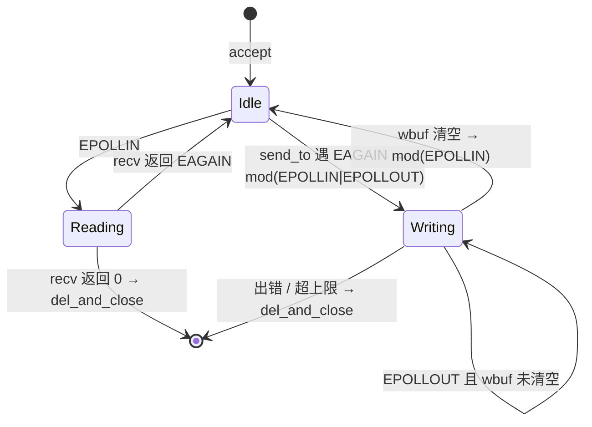

# 2026-11-08 · epoll 阶段 5 收尾：写路径 + 四模型基准

> 目标：把 README §九 阶段 5 的 5 个未勾选项打通，把"epoll 能跑"变成"epoll 可以对比、可以量化"。
> 前提（上午已完成）：`fcntl` 非阻塞 listen fd、`handle_read` 的 `n==0` 分支、`_epfd` 死成员清理、`bench_client.py --msgs` 生效。

---

## 早上实测水位（基准线，一整天都拿这个对照）

`./test/test_04_epoll.sh --no-build --all` 的结果：

| 阶段 | 结果 | 关键数字 |
|---|---|---|
| [1] 功能冒烟 1 连接 | ✅ PASS | `sent=1, recv=1, errors=0` |
| [2] 并发冒烟 50×3 | ✅ PASS | `conn_ok=50`，`150/150` |
| [3] fd 回收 | ✅ PASS | `fd 5 → 5` |
| [4] 空闲连接 500 | ✗ FAIL | `conn_ok=500` 但服务端 `fd=480` |
| [5] 线程数解耦 | ✅ PASS | 20 连接 = 1 线程，500 连接 = 1 线程 |
| [6] 流水吞吐 20×500 | ✅ PASS | `10000/10000`，`partial=0`，**63149 msg/s** |

**5/6 绿。** 唯一红灯 [4] 的根因是 `tcp_server.cpp` 里 `listen(_listen_fd, 5)`，backlog 太小导致 SYN 被丢、客户端靠 TCP 重传慢慢爬。

---

## 下午 13:30–18:00

### ⏰ 13:30–13:50 · 收口阶段 4（20 min）

- [ ] **任务 4.1**：`src/server/tcp_server.cpp` 的 `do_listen()`
  ```cpp
  int listen_res = listen(_listen_fd, SOMAXCONN);   // 5 → SOMAXCONN
  ```
  `SOMAXCONN` 在 `<sys/socket.h>`，Linux 上是 4096。
- [ ] **验收**：`./test/test_04_epoll.sh` → **六段全绿**
- [ ] 顺手跑 `test_03` 确认 `thread` / `pool` 模型没退化（backlog 变大对它们只有好处）

> 先证伪再动手：`hold --conns=500 --hold=15` 期间多次采 `fd` 数。若随时间爬升（480 → 495 → 505），确认是 backlog；若一直 480 不动，是别的问题。

### ⏰ 13:50–14:10 · 第一次 commit（20 min）

- [ ] 把上午的成果锁住（`fcntl` + `n==0` + `--msgs` + test 脚本 + vscode 配置）
- [ ] 提交信息里写明 `test_04` 的 1/2/3/5/6 PASS、[4] 由 backlog 修复

### ⏰ 14:10–15:00 · 写路径设计（50 min）**← 今天最关键**

`handle_write` 还是空壳，`bench_server.cpp` 的回调是：

```cpp
ssize_t n = send(fd, data + sent, len - sent, MSG_NOSIGNAL);
if (n <= 0) { if (n < 0) perror("send"); return; }   // ← EAGAIN 时静默丢弃
```

今天没炸只是因为 `64B × 500 = 32KB` 全被 socket 缓冲区吃下了。

- [ ] **核心矛盾想清楚**：数据要缓存到**连接**上，但 `_msg_cb` 签名只有 `fd`，且住在基类里，不知道 epoll 有 `wbuf`
- [ ] **选方案 ③（推荐）**：基类加 `virtual void send_to(int fd, const char*, size_t)`，默认实现 = 阻塞 send 循环；`EpollServer` 覆盖成"追加 wbuf + 尝试 flush"。**业务层零改动，只把 `::send` 换成 `server->send_to`**
- [ ] 备选 ①：改 `_msg_cb` 签名携带 `Connection` → 破坏 `thread`/`pool`（它们没有 Connection）
- [ ] 备选 ②：回调内自查 `_conns[fd]->wbuf` → 抽象泄漏到业务层
- [ ] `lib/Connection.hpp` 加三个字段：
  ```cpp
  std::vector<char> wbuf;      // 待发数据
  size_t woff = 0;             // 已发送偏移（避免每轮 erase 头部，O(n²)）
  bool want_write = false;     // 已注册 EPOLLOUT 标记，防止重复 mod
  ```
- [ ] **产出**：画出状态机（Idle / Reading / Writing / 关闭）确认想清楚再写代码



### ⏰ 15:00–16:00 · 实现 `handle_write` + `send_to`（60 min）

- [ ] `EpollServer::send_to` 实现：
  1. 查 `_conns[fd]`，查不到直接 return（连接已死，别再写）
  2. `wbuf` 追加 `data[0..len)`
  3. **背压阀**：`wbuf` 超上限（建议 1MB）→ `del_and_close`
  4. flush 循环：`send` 返回 `>0` 累加 `woff`；`EINTR` 重试；`EAGAIN` → 若未注册则 `mod(EPOLLIN|EPOLLOUT)` 并置 `want_write`，return
  5. 全发完 → `wbuf.clear()`、`woff=0`，若 `want_write` 则 `mod(EPOLLIN)` 并清标记
- [ ] `EpollServer::handle_write(int fd)`：只做上面第 4、5 步（flush 段）
- [ ] `bench_server.cpp`：`send(...)` → `g_server->send_to(fd, ...)`，**一行改动**
- [ ] **修 `lib/epoll.hpp` 的 bug**：`bool mod(int fd, uint32_t events = EPOLLIN||EPOLLOUT)` → `EPOLLIN|EPOLLOUT`（`||` 结果是 `1`，默认参数完全失效）
- [ ] **写完必须 `top` 看 CPU**：LT 模式下 `EPOLLOUT` 不摘掉会 100% 忙等

### ⏰ 16:00–16:40 · 造一个真能触发 EAGAIN 的测试（40 min）

**这一步不能省。** 现在 [6] 的 `partial=0` 是**假绿**——数据量太小，没压到发送缓冲区上限。

- [ ] 手动验证命令：
  ```bash
  ./build/bench_server --server=epoll --port=6411 &
  python3 test/bench_client.py --port=6411 --mode=throughput \
          --conns=20 --msgs=2000 --size=4096 --json
  ```
  `20 × 2000 × 4096 = 160MB`，echo 回去必然撑爆发送缓冲区
- [ ] **改之前**记录：`partial > 0` 或 `mismatch > 0`（数据截断）
- [ ] **改之后**记录：`partial == 0, mismatch == 0`（wbuf 兜住了）
- [ ] 把这个对照实验写进 `test_04_epoll.sh` 作为 `[7]` 大包压力阶段
- [ ] 这组前后数字就是写笔记的全部素材

### ⏰ 16:40–17:20 · `IoThreadPool::try_run_one()` 接回 reactor（40 min）

README 阶段 5 第 3 个未勾选项。

- [ ] 打开 `//IoThreadPool _pool;`，构造 `(4, 1024)`
- [ ] 只在 `epoll_wait` 返回 `n == 0`（超时）时调用 `try_run_one()` —— 忙时不该抢 CPU
- [ ] ⚠️ **纪律**：`try_run_one` 让 **reactor 线程**执行池任务，池里必须全是短任务。混进 `sleep(5)`，整个 reactor 停 5 秒（和"5 分钟阻塞任务"是同一个问题）
- [ ] **验收**：`test_04` 六段仍全绿 + `top` 看 CPU 没飙

### ⏰ 17:20–18:00 · `BaseEchoServer` 串行基线（40 min）

README 阶段 5 第 4 个未勾选项，用来做**性能下限参照**。

- [ ] `run_loop()` override：`while (_running) { accept_once → handle_client_read → close }`
- [ ] 复用 `tcp_server.cpp` 里已有的 `accept_once` 和 `handle_client_read`
- [ ] 只有想量化"epoll 到底快多少"时才需要；时间紧可推到明天

---

## 晚上 19:00–22:30

### ⏰ 19:00–20:00 · 四模型基准对比（60 min）

README 阶段 5 最后一项，**今天最出成果的一段**。

- [ ] 写 `test/bench_compare.sh`：循环 `base / thread / pool / epoll` × `hold 500` + `throughput 20×2000×4096`
- [ ] 每个模型采三个指标：线程数（`ls /proc/PID/task | wc -l`）、RSS（`/proc/PID/status` 的 `VmRSS`）、`msg_per_s` + `p99_ms`
- [ ] **产出对比表**（README §五 的素材）：

| 模型 | 500 空闲连接线程数 | 吞吐 msg/s | p99 | RSS |
|---|---|---|---|---|
| base | | | | |
| thread | 501 | | | |
| pool(4) | 5 | | | |
| **epoll** | **1** | ? | ? | ? |

### ⏰ 20:00–21:30 · 阶段 6：长度头协议（90 min）

从"字节流玩具"变成"能承载真实协议"的分水岭。

- [ ] 协议格式：4 字节大端 payload 长度 + payload
- [ ] `Connection` 加 `rbuf` + `rpos`
- [ ] `handle_read` 改成"追加到 rbuf，然后**循环**解析"
- [ ] 解析循环：剩余 < 4 字节 → break；读长度；payload 不够 → break；切出 payload → 回调
- [ ] **单条消息上限**：长度头解析出 `> 16MB` 直接 `del_and_close`（防内存炸弹，否则一个 `0xFFFFFFFF` 就能让服务器 `reserve` 4GB 崩掉）
- [ ] 客户端改成先发 4 字节长度头
- [ ] **验收**：`--size=1` 和 `--size=65536` 都正确回显；`--conns=100 --msgs=100` 零 `mismatch`

### ⏰ 21:30–22:15 · 笔记 + 收尾 commit（45 min）

- [ ] 新增 `note/note_stage5_写路径与半写陷阱.md`，写清四件事：
  1. 为什么 `send` 会半写 —— 发送缓冲区有限，返回 `< len` 是**正常**的，不是错误
  2. `EAGAIN` 的两种语义 —— "现在不能写，等可写事件" vs "现在没数据，等可读事件"
  3. LT 模式下 `EPOLLOUT` 必须摘掉 —— 附 100% CPU 忙等的实测截图
  4. `partial` 怎么被观测到 —— 16:00 大包实验的前后对比数字
- [ ] commit：`feat(epoll): 写路径 wbuf + EPOLLOUT 半写处理 + 四模型基准`
- [ ] push

---

## 今日验收标准

```
□ test_04_epoll.sh 六段全绿
□ 大包测试（20×2000×4096，160MB）partial == 0
□ top 看 epoll 服务端空闲 CPU < 1%
□ 四模型对比表有真实数字
□ 至少一次 commit + push
```

## 卡住就砍（优先级从高到低）

```
1. backlog（15 min）        → 直接六段全绿，先拿成就感
2. 写路径 wbuf（2 h）       → 唯一的 P0 硬骨头
3. 大包验证（40 min）       → 证明第 2 项真的有用
4. commit（20 min）
   —— 以上做完就已经是很猛的一天 ——
5. 四模型对比（数据，可明天）
6. 长度头协议（新功能，可明天）
```

## 今天的三条铁律

1. **每 90 分钟 commit 一次** —— 今天几件事互相耦合（wbuf 改 `Connection`、`send_to` 改基类、`mod` 改 `Epoll`），中途崩了能回滚
2. **一次只改一个缺陷，改完立刻跑 `test_04`** —— 脚本每段重启服务端就是为这个设计的，不要"顺手改三个再一起测"
3. **假绿比红更危险** —— 不是"测试过了"，是"我让它失败过，然后它才过的"

---

## 涉及的已知缺陷（README §八 11 行表）

| # | 缺陷 | 今天是否处理 |
|---|---|---|
| 1 | `send` 遇 `EAGAIN` 直接 return，后半段丢失 🔴 | ⏰ 15:00–16:00 |
| 2 | `handle_write` 空壳，`EPOLLOUT` 未注册 🔴 | ⏰ 15:00–16:00 |
| 3 | `_epfd` 废弃成员 ⚪ | ✅ 上午已完成 |
| 7 | `listen(fd, 5)` backlog 过小 🟡 | ⏰ 13:30 |
| 9 | `_idle_fd` 定义了没启用 🟡 | 未排期 |
| 10 | 无连接数上限 / 无空闲超时（slowloris）🟠 | 未排期（阶段 7） |